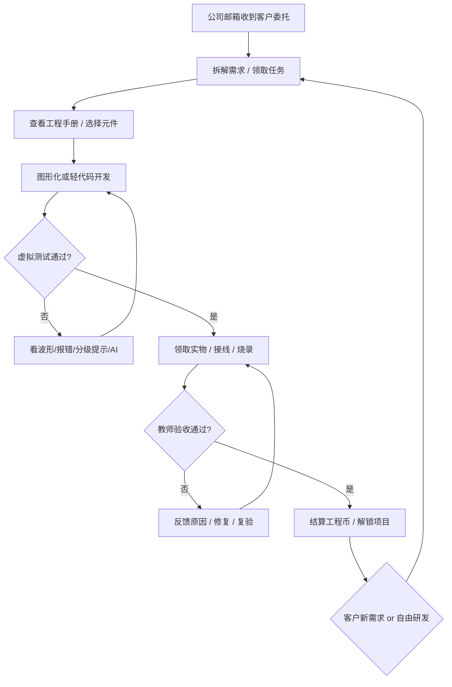
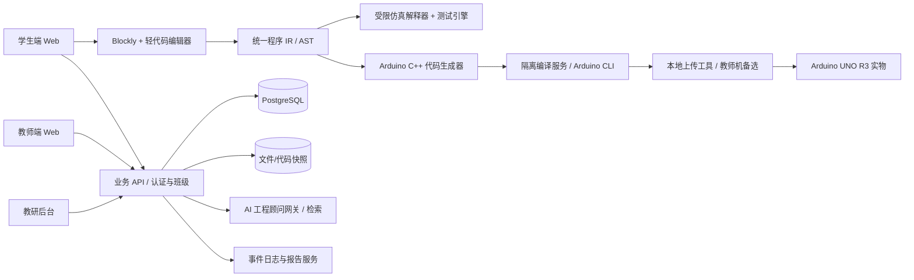

# Engineer Quest｜未来工程师沉浸式职业探索游戏

**完整产品需求与开发实施计划书（PRD V1.0）**  
**产品类型：** Web 沉浸式工程职业模拟游戏 × 4 小时线下高中生探索课程 × Arduino 实物实验  
**适用对象：** 高中生（零基础优先，兼容有编程经验学生）、任课教师、助教、课程管理员  
**交付属性：** 可供产品经理、UI/UX、前端、后端、游戏/关卡策划、课程老师与测试团队共同使用的开发基线  
**重要说明：** 本文件是立项版本，不代表相关软硬件集成已经完成实机验证；所有“建议方案”须以技术 Spike 验证结果为准。

> **一句话定位：** 让学生在 4 小时内“入职”一家虚构智能硬件公司，完成从客户需求、图形化编程、轻代码、虚拟电路、真实 Arduino 烧录与接线，到测试交付、赚钱购件和自由研发的完整工程师闯关体验；通过真实参与而非单次测评探索未来专业方向。

## 0. 文档阅读说明与开发决策

### 0.1 优先级定义

| 标识 | 解释 | 研发含义 |
|---|---|---|
| P0 | 首期试点必须有 | 不满足不进入正式授课 |
| P1 | 建议在试点版完善 | 可在首批试点后迭代，但应预留架构 |
| P2 | 沙盒版/扩展版本 | 不影响首期 4 小时课程上线 |
| Spike | 开工前验证的技术假设 | 验证失败时必须按备选路径调整 |

### 0.2 已确认的产品方向

- 使用《SHENZHEN I/O》启发的“员工入职、邮件接单、硬件手册、编程解谜、测试交付、成本优化”模式，**但采用独立原创的世界观、界面、文本、关卡与美术，不复制其版权内容**。
- 采用 **方案 B：同一项目中的多岗位轮换**，而非只扮演软件程序员。
- 关卡学习路径：**图形化积木 → 真实 Arduino C/C++ 的受限轻代码编辑 → 虚拟接线与仿真 → 实体接线与烧录 → AI 辅助迭代 → 自选零件/创新设计**。
- 网站驱动几乎全部教学：背景、任务下发、知识材料、编程、模拟、提交、商城、AI 助手、教师验收、结业报告。老师负责安全、极短关键知识讲解、实物验收和教学反馈。
- 引入游戏币、关卡、角色、客户消息、成就、零件商城、分支开发、教师通关码/扫码验收。
- **主任务一定可达，创新挑战允许分化**：零基础小组可完成核心硬件交付，有基础小组可挑战进阶功能。

### 0.3 首期关键决策建议

| 决策项 | 推荐首期选择 | 理由 / 保留条件 |
|---|---|---|
| 主线产品 | 校园智能环境控制终端（V1：感光灯控；V2：手动模式） | 需求熟悉、实验反馈直观，可自然扩展 |
| 实物主板 | Arduino UNO R3，统一同一采购批次 | 教学资料成熟；需要实测驱动/USB/板载芯片差异 |
| 主线元件 | UNO R3、面包板、LED、电阻、光敏模拟输出模块、按键、杜邦线 | 只使用低压小电流教学电路；不接市电 |
| 图形化模块 | Blockly（经许可核验） | 自定义积木和代码生成空间大 |
| 轻代码 | **真实 Arduino C/C++ 子集 + 补全/局部修改** | 避免学习一门不能烧录的伪语言 |
| 软件仿真 | 自研“受限逻辑与接线校验器”，支持主线 4–6 种元件 | 可控性优先，不把完整 SPICE 仿真当作首期前置条件 |
| 烧录 | 第一版教师机/学生机预装 Arduino IDE/CLI，网站指导流程；一键烧录列为 Spike | Web Serial 不等同于浏览器已具备可靠的 UNO 烧录器 |
| AI 助手 | 网站内任务感知型工程顾问：分级提示、资料检索、调试辅导 | 降低直接代做与错误接线风险 |
| 实物验收 | 教师端观察实物 + 扫码/一次性码签发 | 网站无法仅凭“通过虚拟测试”证明真实设备正常 |
| 班级假设 | 24 人、8 组、每组 3 人、1 主讲 + 1–2 助教 | 用于估算并发和课堂运营，试点前核验 |

---

# 1. 项目背景、目标与产品边界

## 1.1 合作背景与问题

留学规划合作方需要让高中生在选择专业前真正了解计算机与电子工程领域的工作方式。单纯讲专业介绍难以形成真实判断；只学编程或拼装电路又容易退化为普通科技体验营。项目因此通过游戏化的研发工作流，把“职业探索、技能入门、真实交付、个人反思”连接起来。

## 1.2 产品目标

**G1｜职业认知：** 学生能够说清楚产品经理/系统工程、电子硬件、嵌入式软件、质量测试等角色如何协作。  
**G2｜技术体验：** 了解输入—处理—输出，能识别循环、条件判断、变量和引脚，完成至少一次虚拟测试。  
**G3｜真实工程：** 小组完成至少一次 Arduino 实物连接、程序烧录、故障排查与教师验收。  
**G4｜游戏动机：** 通过邮件剧情、项目报酬、零件商城和进度反馈产生可持续探索意愿。  
**G5｜后续规划：** 学生生成一份可复盘的兴趣探索报告，为计算机科学、计算机工程、电子电气工程、机器人、产品/测试相关方向的后续咨询提供讨论材料。

## 1.3 非目标（V1 不做）

- 不在 4 小时内教授完整 C/C++ 或芯片底层寄存器开发。
- 不承诺“完成课程即可掌握嵌入式工程”或单次活动可判断大学专业适配度。
- 不自研通用物理电路仿真器、完整 PCB CAD、机器人 3D 物理引擎。
- 不保证浏览器跨所有操作系统/串口芯片一键烧录；先兼容限定设备清单。
- 不引入家用 220V 交流电、锂电池裸电芯、焊接教学或高功率执行器。
- 不开发真实货币支付、学生公开排行榜/社交广场、AI 自动评定职业适合度。
- 不从《SHENZHEN I/O》复用名称、原始文本、图标、角色、源代码和关卡素材。

## 1.4 用户角色与主要任务

| 用户 | 核心诉求 | 系统能力 |
|---|---|---|
| 零基础学生 | 不害怕进入游戏，失败可修复，能做成真实东西 | 分级提示、可视化反馈、自动保存、鼓励式关卡 |
| 进阶学生 | 不被低阶任务拖住，可研究更深功能 | 高阶可选目标、代码编辑、优化测试、自由购件 |
| 学生小组 | 明确分工、合作推进、不因一个人卡住 | 组队/岗位轮换、共享项目版本、任务板 |
| 主讲老师 | 尽量不讲长课，能看到卡点和验收请求 | 教师大屏、进度热力图、审批、广播与救援 |
| 助教 | 快速定位软硬件问题，处理设备故障 | 工位状态、故障码、替换设备与救援流程 |
| 运营/教研管理员 | 复用课程、配置班级、复盘教学 | 关卡配置、模板复制、报告导出、统计与权限 |

## 1.5 成功指标（待试点校准）

**课程完成：** ≥90% 学生完成 Blockly 关卡；≥80% 小组完成实物核心关卡；≥95% 参与职业反思。  
**时长适配：** 80% 小组在课时第 210 分钟前进入展示/提交。  
**学生体验：** 课后“希望继续体验工程方向”自评 ≥70%（意愿指标，不作为教育成效证明）。  
**可用性：** 无影响全班的 P0 级故障；学生关卡关键操作完成率 ≥95%。  
**AI：** 回答可用率、救援请求频率与“AI 导致错误接线建议”的事件数需单独统计。  
以上均为**首轮设计目标/假设**，不是现有历史数据。

---

# 2. 体验原则与游戏设计体系（GDD）

## 2.1 七项体验原则

1. **先工作任务，后知识讲解。** 在真实问题情境中引出循环、判断、引脚。
2. **先虚拟成功，再物理验证。** 虚拟容错低门槛，实体强调现实世界反馈。
3. **游戏可失败，学生不可被淘汰。** 有回退、修复、提示与教师救援。
4. **多个正确方案。** 在约束下通过行为测试，比匹配标准答案更重要。
5. **游戏化奖励解决问题，而不是奖励速度或少用 AI。** 不做负向智力标签。
6. **鼓励合作、兼顾个人体验。** 小组共享产品成果，个人记录兴趣选择。
7. **AI 作为协作工具。** 必须由学生观察、解释、验证输出。

## 2.2 核心游戏循环



## 2.3 双重成长系统

**工程线：** 关卡、项目版本、技能解锁、零件、工程币、工作称号、产品发布。  
**职业探索线：** 岗位轮换、参与活动、个人反思、兴趣变化、困难处理、后续探索建议。  
两个系统分别记录，不能把“代码对/错”自动等同于“职业适配”。

## 2.4 世界观、剧情与 NPC（独立原创）

- **虚构公司：** NEXUS LAB（暂定，商业使用前检索名称商标）。
- **学生身份：** 研发实习生；组队进入“校园智能设备事业部”。
- **林主管（研发经理）：** 发布工作分解与截止时间。
- **陈工（硬件负责人）：** 提供器件手册、接口与安全提醒。
- **许工（测试负责人）：** 给出测试用例、提交 Bug 工单。
- **客户王老师（校园管理者）：** 提需求、变更需求、验收产品价值。
- **AI 工程顾问 Aiden（暂名）：** 解答术语、排障、讲解代码，不代替老师批准实体电路。

剧情风格：接近真实公司内部办公系统，有适量轻松幽默；不得用羞辱、扣薪恐吓、辱骂客户等负面职场内容制造“真实感”。

## 2.5 游戏币与经济平衡

- 货币：**EC（Engineering Credit，工程币）**，仅游戏内使用、不能兑换现金或真实资产。
- 每组初始：**500 EC**；基础板卡与主线必需材料为“公司资产”，免费领用，不需要购买。
- 推荐任务奖励：L1 +100、L2 +150、L3 +200、L4 +300、L5 +200（通过后结算一次）。
- 扩展商品初始价格：蜂鸣器 100 EC、按键 50 EC、超声波模块 250 EC、OLED 350 EC、舵机 300 EC；价格是游戏数值而非采购价。
- 基本规则：永不扣除主线保底资源；失败不扣钱；退货/换购允许；价格可由后台配置；不采用不可逆惩罚。
- 可选工程评分：通过测试（基础）、可解释性（加分）、成本合理（加分）、用户体验（加分）。不得因使用提示或 AI 而禁止结业。

## 2.6 角色轮换机制

3 人一组时，每个阶段指定主导：需求负责人、软件负责人、硬件/测试负责人；下一阶段轮换。一个学生可以同时承担两个角色，但必须在个人档案记录是否亲自做过代码编辑/实物连接/测试。

| 阶段 | 主导角色 | 其他学生必做行为 |
|---|---|---|
| 客户需求 | 产品/系统 | 每人提出一个澄清问题 |
| 图形化与轻代码 | 软件 | 每人修改或解释一次逻辑 |
| 虚拟电路 | 硬件 | 每人辨认或连接至少一个引脚 |
| 实体实验 | 硬件+测试 | 每人参与一项安全检查与测试 |
| 扩展与交付 | 轮换 | 每人提交个人反思 |

---

# 3. 核心课程：4 小时运行脚本（240 分钟）

| 时间 | 游戏/课程关卡 | 学生行动 | 网站自动行为 | 教师角色与验收 |
|---|---|---|---|---|
| 00–12（12m） | L0 入职 | 建立小组、读客户邮件、分岗位 | 赋予身份、发初始 EC、开启项目 | 2 分钟欢迎+安全规则 |
| 12–35（23m） | L1 积木编程 | 输入/输出、循环、条件，点亮虚拟灯 | 自动判定行为测试 | 仅巡场；全组需体验 |
| 35–65（30m） | L2 轻代码解谜 | 修改真实 Arduino 代码中的条件、变量和循环 | 生成代码对照、执行测试 | 讲解 3–5 分钟“代码与硬件关系” |
| 65–105（40m） | L3 虚拟电路 | 认芯片、读引脚图、连虚拟电路、仿真 | 接线规则检查+自动测试 | 发起 2–3 个巡回提问 |
| 105–115（10m） | 休息 | 停机离席 | 保留进度 | 检查设备 |
| 115–165（50m） | L4 真实硬件 | 领取套件、按图接线、烧录、跑测试 | 提供步骤和上传检查表 | **实物安全与功能验收，签发通关** |
| 165–205（40m） | L5 客户变更+AI | 任选“手动模式/稳定性/显示提示”升级 | 新邮件、AI 辅导、小游戏测试 | 安全审查与定向救援 |
| 205–230（25m） | L6 产品交付 | 演示、展示 Bug 修复/未完成项、采购提案 | 生成交付报告、工程币结算 | 3–5 分钟/组抽样验收/集中演示 |
| 230–240（10m） | L7 职业反思 | 个人完成岗位兴趣记录 | 生成个人探索卡 | 简短点评与后续方向说明 |

**现实约束：** 25 分钟无法保证 8 组每组都做长时间现场展示；L6 应采用“教师巡回验收 + 部分代表展示 + 全组线上交付”方式。L5 进阶作品属于挑战，不得阻碍 L6 的保底结业。

**时间保护：** 课堂时间进入 T=155 分钟仍有小组未完成烧录时，教师端可触发“护航模式”：给出经过验证的基础程序/更简洁接线方案，优先保证实物体验并记录已启用支持，不算作弊。

---

# 4. 关卡详细规范（开发与教研共同签收）

## L0｜第一天上班：接到客户订单

**学习目标：** 学生理解企业中的需求—研发—测试—交付链路。  
**进入条件：** 班级/小组创建成功。  
**输入：** 公司欢迎信、客户王老师来信、有限预算、组员岗位卡。  
**学生行为：** 阅读需求，选择一项必须做的功能，给客户提出一个澄清问题，完成安全承诺。  
**产物：** 任务确认单（结构化字段）、3 人小组岗位分配、初始兴趣基线。  
**通过标准：** 每组提交问题及初始功能理解；非自动给“人格评分”。  
**提示/救援：** 点击关键术语弹出白话解释；不输入长篇文字亦可从候选问题选择并改写。

**示例客户消息：**

> “自习室经常忘记关灯。我想要一个会根据环境明暗自动控制灯光的小设备。最好以后还能增加人工操作。你们先做一个能够演示的版本。预算有限，请优先保证稳定和安全。”

## L1｜零基础积木：让信号听指挥

**学习目标：** 顺序、重复、`if/else`、数字读写和输入输出。  
**输入：** 提供虚拟 LED、虚拟光照条，Blockly 预置“重复执行/读取亮度/如果/开关灯”等积木。  
**微任务：** L1A 让 LED 每秒闪烁；L1B 光照值低于阈值打开 LED，否则关闭；L1C 调整阈值解决测试样例。  
**验收用例：** 明亮=850（0–1023 逻辑读数）→ LED OFF；暗处=150 → LED ON；变化 150→850→150 时输出 ON→OFF→ON；禁止仅给出固定常量输出。  
**生成结果：** 可读的积木 JSON/AST、实际 Arduino C++ 预览、测试截图记录。  
**通过标准：** 3 个用例通过，状态显示 PASS。  
**失败反馈：** 明确“第 2 步模拟光线已变亮，但 LED 仍为 ON”，并高亮积木分支。

## L2｜轻代码挑战：从积木到真正的程序

**学习目标：** 学会读和改 Arduino C/C++ 的受限实际代码，理解 `setup()`、`loop()`、`if/else`、`int`、`digitalWrite()`、`analogRead()` 与 `delay()`。  
**路线：** L1 积木生成代码 → 并排逐句高亮 → 填空式代码（修改阈值/条件）→ 补写一段 `if/else` 或循环。  
**解谜风格：** 借鉴编程解谜游戏的“输入序列—预期输出—逐步运行—最短/可解释方案”反馈，而非复制《SHENZHEN I/O》的专有汇编指令。  
**任务：** 修复代码中被故意改错的比较符号、条件顺序或引脚编号。  
**通过标准：** 受限静态校验、编译检查或 AST 校验通过；3 个输入序列行为测试均通过。  
**产物：** 最终可追溯的代码快照及版本号。  
**重要限制：** Blockly → 代码单向生成；学生开始自由编辑代码后，不要求自动无损反向还原为积木。系统保存“进入代码模式前快照”，需要切回时明确提示可能覆盖当前代码。

**教学代码示例（阈值须适配实际传感器方向/标定结果）：**

```cpp
const int LED_PIN = 9;
const int LIGHT_PIN = A0;
const int THRESHOLD = 450;

void setup() {
  pinMode(LED_PIN, OUTPUT);
}

void loop() {
  int light = analogRead(LIGHT_PIN);
  if (light < THRESHOLD) {
    digitalWrite(LED_PIN, HIGH);
  } else {
    digitalWrite(LED_PIN, LOW);
  }
  delay(100);
}
```

**实现要求：** 上述代码是对“较小值表示暗”的示例假设，真实硬件必须按统一采购模块实测光照值与阈值方向，必要时自动反转条件；不得未经校准把任意光敏模块当作与模拟器完全一致。

## L3｜虚拟工程台：开发板、电路和接口

**学习目标：** 引脚与 IO、供电、GND、传感器 AO、LED 极性、限流电阻；理解引脚名称与代码中的变量关系。  
**输入：** UNO R3 可交互针脚图、带端子的 LED+电阻、光敏 AO 模块、按钮（可选用于后续）；元件手册（“用途/接口/常见错误/安全”）。  
**操作：** 拖元件到工程台、连接导线、检查连线、切换虚拟亮度、运行 L2 程序。

**统一主线引脚约定：**

| 设备 | UNO 连接建议 | 备注 |
|---|---|---|
| LED | D9 → 220Ω 电阻 → LED 正极，负极 → GND | 仅适用于普通小 LED；元件极性和电阻位置示意要准确 |
| 光照模块 | VCC → 5V，GND → GND，AO → A0 | 必须选有模拟输出的统一模块，实测极性 |
| 按键（L5） | D2 ↔ 按钮 ↔ GND，代码用 `INPUT_PULLUP` | 按下为 LOW；课堂讲清逻辑反转 |
| 显示屏（扩展） | I2C 接口按指定模块引脚要求 | 首期不作为核心必达项 |

**仿真要求：** 首期不假装模拟真实电阻/电流/噪声的全部物理特性；实现“元件实例 + 引脚拓扑规则验证 + 逻辑输入模拟 + LED 状态渲染 + 自动测试”。  
**验收：** 电源/信号/地连线正确、程序期望的引脚与接线一致，3 个虚拟输入测试通过。  
**故障案例：** A0 接错为 A1、LED 正负极反接、忘记 GND、D9 与代码 D8 不一致。  
**产物：** 接线 JSON、测试结果、拟用于实物接线的线路清单。

## L4｜真实工程台：Arduino 连接、烧录与调试

**学习目标：** 看实物板型、遵守用电安全、按清单接线、选择串口、编译/上传、观察设备真实响应。  
**流程：** 领取套件 → 断电布线 → 教师/助教安全检查 → USB 上电 → 选择板型/端口 → 烧录 → 依照明暗场景测试 → 如失败进入排障清单。  
**必备软硬件：** 预装可用编译/上传工具、固定型号 UNO R3、USB 数据线、备用线与电阻、可用编译好的保底程序。  
**通过标准：** 现场观察 LED 根据光照变化正常动作；引脚连线安全；由教师在后台签发 `HARDWARE_ACCEPTED`。  
**失败类别：** 接线错误 / 驱动或端口错误 / 未编译 / 程序逻辑错误 / 传感器标定错误 / 设备故障；可转助教工单，不直接扣分。  
**救援：** 依序提供“照片/示意检查 → 端口诊断 → 预编译程序 → 更换线材 → 更换板卡”路径。

## L5｜客户变更与 AI 协作：让产品变得更好

**剧情：** 客户来信：“自动开关很方便，但有人临时要让灯保持常亮；另外灯在临界光线附近可能反复闪烁。请你们至少选一个问题改进。”  
**必达目标：** 每组选择一个可执行升级（或经老师批准完成稳定性优化），在网站提交解释、测试及结果。  
**可选升级方向：**

| 分支 | 新元件 | 学习点 | 4 小时内建议 |
|---|---|---|---|
| A 手动/自动模式 | 按键（免费或 50 EC） | 变量、状态、`if/else`、交互 | **首选**，便于统一验收 |
| B 防抖/防闪烁 | 无 | 滞回阈值、延时、边界测试 | **推荐**，纯软件可完成 |
| C 设备状态显示 | OLED（350 EC） | I2C、库、接口、信息设计 | 进阶；需提前装好库并验证 |
| D 报警提醒 | 蜂鸣器（100 EC） | 多输出、触发规则、用户体验 | 进阶；可控性较高 |

**AI 助手：** 页面自动携带板卡型号、元件、已知引脚、关卡目标、模拟报错和学生求助内容。默认从“一个诊断问题”开始，经两轮提示可提供更完整示例；有救援需求时允许直接查看示例，但要留有“解释这个改动为什么有效”任务。  
**验收：** 至少展示一次升级的输入/输出变化，提交变更记录。可允许“虚拟验证已通过、实物扩展未完成”但不能冒充硬件已验收。

## L6｜客户演示、产品交付与结算

**任务：** 提交最终版本、功能说明、测试清单、1 张实物照片或现场验证标记（拍照非强制，须有家长/学校许可规则）、已知问题以及后续改进建议。  
**系统：** 生成项目版本卡和交付摘要；发放奖励并解锁“自由产品设计”入口。  
**教师：** 抽检实物和产品解释，必要时拒绝验收并写明可修复的具体原因。  
**通过标准：** L4 的 `HARDWARE_ACCEPTED` + L6 交付信息完整；未做完进阶分支不会导致课程失败。

## L7｜我的第一份工程师档案

**个人输入：** 体验过的工作环节；最投入与最不喜欢的任务；困难与处理方式；对专业的新的理解；下一次想继续尝试的职业。  
**输出：** 个人职业探索记录卡（非职业适配测评、非教育成绩预测）及小组产品页。  
**建议的下一站：** 根据个人选择提供“电子电气/计算机工程/计算机科学/机器人/人机交互/测试质量”等进一步体验建议，不自动判定适合/不适合。

---

# 5. 关卡题库与测试向量（首发可配置）

## 5.1 首发关卡清单

| ID | 关卡标题 | 关键概念 | 验收方式 | P级 |
|---|---|---|---|---|
| L0-01 | 第一天上班 | 职业角色/需求 | 提交客户澄清问题 | P0 |
| L1-01 | 闪烁的信号灯 | 顺序/循环/延时 | 自动输出时序 | P0 |
| L1-02 | 天暗才开灯 | 输入/比较/分支 | 自动输入向量 | P0 |
| L2-01 | 修复错误条件 | `if/else` 轻代码 | 静态+行为测试 | P0 |
| L2-02 | 修复错误引脚 | 变量/硬件映射 | 静态+行为测试 | P0 |
| L3-01 | 找到正确接口 | UNO引脚/供电/GND | 拓扑检查 | P0 |
| L3-02 | 虚拟照明设备 | 代码+接线协同 | 联合模拟测试 | P0 |
| L4-01 | 第一次烧录 | 板卡/串口/实体连接 | 老师实物验收 | P0 |
| L5-01 | 手动控制变更 | 按键/状态机 | 升级测试 | P0（允许替代） |
| L5-02 | 消除闪烁 | 阈值/滞回 | 升级测试 | P1 |
| L5-03 | 追加设备显示 | I2C/显示 | 可选测试 | P1 |
| L6-01 | 交付报告 | 产品表达/团队协作 | 老师签核 | P0 |
| L7-01 | 职业探索报告 | 自我反思 | 个人提交 | P0 |

## 5.2 测试向量示例

| 场景 | 输入序列（亮度 ADC 模拟） | 期待输出 | 常见缺陷 |
|---|---|---|---|
| 暗环境 | 150 | ON | 方向写反、变量未更新 |
| 亮环境 | 850 | OFF | 只写了 if 没有 else |
| 明暗变化 | 150→850→150 | ON→OFF→ON | 循环未执行、状态未更新 |
| 阈值边缘 | 445→455→445（阈值450） | 按规则响应；升级后应稳定 | 反复闪烁，无滞回 |
| L5 手动锁定 | 暗→手动 ON→亮 | 保持 ON 直到退出手动模式 | 传感器仍覆盖手动模式 |

**重要：** 这里的 150/850 是**虚拟校验数值**，不是所有光敏模块实物一定产生的绝对数值。实体测试必须先校准并明确“亮/暗”方向。

## 5.3 提示与失败反馈机制

- H0：先反馈“期望行为 vs 实际行为”，定位哪组输入失败。
- H1：定位检查范围，如“读入亮度后，哪条分支会被执行？”
- H2：提供相关手册段落、高亮错误接线或易错代码。
- H3：给局部代码/连线示例，或发助教救援卡。
- H4：需要时可进入教学护航模式，直接加载保底版本继续实物环节。
- 任何提示、回退、老师协助都不能使学生永久失去主线资格。

---

# 6. 网站信息架构、页面功能与视觉设计

## 6.1 一级导航（学生端）

**工作台 / 公司邮箱 / 研发工位 / 项目任务 / 元件商城 / 工程手册 / 个人档案**。AI 工程顾问作为右侧全局抽屉，任何关卡可打开，但按任务上下文配置不同建议。

## 6.2 页面清单与需求

| 页面 ID | 页面 | 关键组件 | 用户操作 | 通过标准 |
|---|---|---|---|---|
| UI-01 | 登录/班级加入 | 邀请码、匿名昵称、班级提示 | 输入邀请码、确认小组 | 成功恢复已有进度 |
| UI-02 | 入职/剧情 | 邮件、角色卡、需求摘要 | 阅读、拆分需求 | 不跳过关键安全提示 |
| UI-03 | 项目工作台 | 关卡地图、任务摘要、进度、EC | 进入已解锁关卡 | 刷新恢复正确状态 |
| UI-04 | 编程工位 | Blockly、代码预览、轻代码、测试面板 | 编辑、运行、保存 | 修改前后版本可回退 |
| UI-05 | 虚拟硬件台 | UNO 针脚图、元件拖拽、连线、传感器控件 | 接线、检查、仿真 | 能指出错误引脚/缺地 |
| UI-06 | 公司邮箱/工单 | NPC 邮件、附件、需求变更 | 查看、接受、记录 | 新工单可配置触发 |
| UI-07 | 工程手册 | 元件卡、接线图、示例、检索 | 查找参数/常见错误 | 支持按型号查资料 |
| UI-08 | 元件商城 | 库存、EC、选择、购物篮 | 购买、退货、领料 | 账本一致、库存正确 |
| UI-09 | 实物验收 | 自检表、二维码/短码、状态 | 请求老师验收 | 无老师签名不可过关 |
| UI-10 | AI 工程顾问 | 上下文、聊天、参考资料 | 提问/获取分级帮助 | 错误/超时可降级 |
| UI-11 | 个人探索档案 | 反思表、兴趣偏好、项目作品 | 编辑/提交/下载 | 不生成武断适配结论 |
| UI-12 | 教师控制台 | 小组状态、审批、广播、救援、配置 | 签核、暂缓、解锁、导出 | 权限与审计健全 |
| UI-13 | 管理/教研后台 | 关卡管理、库存管理、班次、数据报表 | 发布版本/复用模板 | 已开课班级不受更新破坏 |

## 6.3 页面布局建议

**学生工作台：** 顶部为公司 Logo/员工等级/余额；左侧为关卡进度；中间为当前工单和“开始研发”主 CTA；右侧为 NPC 消息、项目状态与 AI 入口；底部为职业探索进度提示。  
**编程工位：** 左侧任务要求及手册入口（20%）；中间积木/代码编辑器（50%）；右侧运行输出、测试用例与实时状态（30%），AI 抽屉浮于右侧，可折叠。  
**虚拟硬件台：** 中央大画布和板卡（65%）；右侧物料与引脚手册（20%）；底部模拟状态/报错区（15%）。  
**教师控制台：** 以 8 组卡片显示每组所在关卡/最后活动/帮助请求/验收队列，可批量广播，不直接替学生输入答案。

### 6.3.1 研发工位文字线框图

```text
┌───────────────────────────────────────────────────────────────────┐
│ NEXUS LAB   PROJECT 001   LV.1  EC 850     [邮箱] [手册] [AI顾问] │
├─────────────────┬────────────────────────────┬────────────────────┤
│ 客户需求/验收项  │    [积木]  [Arduino代码]    │ 测试面板/输出      │
│ ─────────────── │ ────────────────────────── │ 输入: 光照 150    │
│ □ 阴暗点亮      │  Blockly工作区 /代码编辑器  │ 期望: LED ON      │
│ □ 明亮关闭      │                            │ 实际: LED OFF     │
│ □ 循环检测      │                            │ [运行测试] [帮助] │
│ [查看资料]      │     [保存] [运行] [版本]    │ 3条用例 2/3通过   │
├─────────────────┴────────────────────────────┴────────────────────┤
│ [上一步]        [提交软件测试]              当前关卡 L2-01        │
└───────────────────────────────────────────────────────────────────┘
```

## 6.4 视觉设计规范（建议）

- **风格：** “科技公司内部工位 + 轻赛博工业设计”，高级克制，避免儿童化卡通和过度密集的真实 IDE。
- **色彩：** 深海军蓝 #101827（主背景）、炭灰 #1B2738（面板）、冷青 #36CFC9（可交互/信息）、暖黄 #F7C65F（奖励/商店）、红 #E96767（错误），结合浅色阅读底。色彩需要通过 WCAG 对比度测试。
- **字体：** 中文无衬线系统字体；代码使用等宽字；正文 15–16px，代码 14–15px，不用大量极小字号。
- **动效：** 邮件出现、关卡通过、领取 EC、解锁配件可微动效；需提供减少动态效果模式。
- **可访问性：** 不只用颜色表示测试是否通过，错误信息配图标和文本；键盘焦点可见；字号可放大。
- **声音：** 默认静音或低音量，提供开关；教学课堂不以音效形成噪声干扰。
- **设备：** 首期桌面浏览器 1366×768 及以上；教师控制台支持平板/手机查看，不要求学生手机编程。

## 6.5 交互细节

- 自动保存：积木、代码、接线改动经过节流后自动持久化；可手动保存快照。
- 测试失败：列出“输入—期望—实际”而非只显示红叉；可重复测试。
- 未满足前置：展示具体原因，例如“请先完成 L3 虚拟接线测试”。
- 页面误关/断网：重连后恢复；显示保存时间和同步状态。
- 切换编辑模式：提示“一旦开始手写代码，返回积木可能丢失未映射改动”，提供另存版本。
- AI 助手：默认给出调试思路和文档链接，不自动替换代码，所有建议需由学生明确确认。
- 教师验收：学生“请求验收”进入队列；老师扫码或输入教师端一次性验证码，学生页面实时解锁。

---

# 7. 核心技术架构（供技术负责人评审）

## 7.1 目标架构



**建议实现：** 前端 React + TypeScript + Blockly + Monaco/CodeMirror + SVG/Canvas 工位；后端 FastAPI/NestJS 等均可（由开发团队现有能力决定）；PostgreSQL 保存业务数据；对象存储保存快照；Redis 用于可选的短时协作/队列；WebSocket/SSE 通知关卡解锁。**这里是推荐方案，不是对技术栈的强制要求。**

## 7.2 单一程序逻辑链（P0 硬约束）

推荐采用**受限统一程序中间表示（IR/AST）**作为主线唯一可信源：

1. Blockly 积木 → 结构化 AST（预置类型检查与合法引脚）。
2. AST → 可执行的轻量仿真逻辑（不用 `eval` 执行学生输入代码）。
3. AST → 经过约束的 Arduino C++ 源码。
4. 学生进入轻代码编辑时，限定允许编辑的真实 C++ 子集，并解析/转换回支持的 AST；暂不支持的语法直接明确提示。
5. 编译生成的同一份 C++ 源码用于 Arduino CLI，而非向实物偷偷替换成另一套程序。
6. 所有测试和实物验收绑定 `program_version_id` 与 `wiring_version_id`，避免“先通过、再改代码”继续通关。

**不要求自动双向无损转换：** 自由文本模式未必能回到原积木视图；进入代码模式必须先快照。进阶版本可支持更大 C++ 子集，但不影响首发主线。

## 7.3 限定语言能力（首期白名单）

允许：常量整数、布尔、简单变量、比较（`< > ==`）、逻辑与/或、`if/else`、循环 `loop()`、 `analogRead`、`digitalRead`、`digitalWrite`、`pinMode`、`delay`、基础运算。  
首期不允许：任意头文件、指针、动态内存、递归、无线网络、文件 IO、数组越界实验、任意外部库、自定义底层寄存器访问。  
需要防护：循环/延时执行预算、模拟步数上限、编译执行超时、源文件大小限制、用户代码不能直接在业务服务的宿主进程执行。

## 7.4 仿真系统边界

首期是**逻辑级模拟 + 拓扑规则校验**，非通用电路 SPICE：

- 元件模型：UNO R3、LED、限流电阻、光敏 AO、按钮、蜂鸣器（可选）、OLED（后续）。
- 逻辑模型：按关卡输入向量更新模拟模拟量/数字量，再运行程序 IR 输出 LED 等状态。
- 连线验证：电源/地/信号拓扑、引脚号、LED 极性、是否具有限流电阻、不得短接 5V/GND 的规则；支持动态提示。
- 学生能看见“虚拟接线影响程序读取/输出”，但不对电流/噪声/复杂芯片行为作不实保证。
- 后续如要真实 MCU 指令级仿真，可评估 Wokwi 等服务；商用许可、API 嵌入、自动化测试能力、支付计划须在签约前单独验证。

## 7.5 Arduino 编译与实体烧录的双路径

**A｜首期稳定方案（推荐默认）：** 网站生成 `.ino`；本机预装 Arduino IDE/CLI；学生按网站指导选择 `Arduino Uno` 与串口并上传；出现失败由助教接管。网站记录版本与教师结果，但不声称从本机自动读取验证状态。  
**B｜一键烧录（Spike）：** 服务端用 Arduino CLI 在隔离环境编译出 HEX，浏览器通过 Web Serial + 相容 bootloader 协议上传，或通过本地小型桥接程序调用 Arduino CLI。要验证 Windows/macOS、板卡 USB 桥接芯片、端口占用、驱动、设备重连与回滚。  
**上线判据：** 至少在目标授课设备清单上做持续实机测试；若 B 未通过，不能以“未来补做”为由阻塞 A 路线的课程交付。

## 7.6 轻代码编辑器设计

- V1 采用“渐进揭示”：先只让学生补全 `< 450`、`HIGH/LOW`、`delay()` 参数；之后解锁 10–25 行真实 Arduino C++ 核心代码。
- 代码编辑器显示三栏辅助：左侧“我要实现的行为”，中间真实代码，右侧模拟输入/输出。
- 光标点击语法，解释 `setup()`/`loop()` 等对应的工程含义；点代码行可高亮关联积木（只在存在映射时）。
- 保存内容包括源代码、AST、板卡目标、引脚映射、测试用例版本；触发重新测试后才能再次进入实体验收。

---

# 8. 产品功能需求与用户故事

## 8.1 身份/班级/小组（P0）

**FR-001** 教师创建班级场次，设开始/结束时间、邀请码、容量、课程版本。  
**FR-002** 学生使用临时邀请码加入，不要求填写真实姓名；昵称和小组 ID 唯一。  
**FR-003** 3 人小组共享工程进度，但个人反思和兴趣记录各自保存。  
**FR-004** 允许教师补录学生、替换设备、调整组员；所有变更记录审计。  
**FR-005** 账号/角色权限严格区分学生、教师、助教、教研、管理员。

## 8.2 任务与故事引擎（P0）

**FR-010** 关卡由版本化内容配置驱动，支持前置、触发、NPC 消息、技能标签、分支、时间窗口、奖励。  
**FR-011** 关卡状态：`LOCKED → AVAILABLE → IN_PROGRESS → SUBMITTED → PASSED/NEEDS_FIX`。  
**FR-012** 自动测试通过后不应直接把 `HARDWARE_ACCEPTED` 置为通过。  
**FR-013** 教师可按班级启动剧情消息/延时触发，支持“课堂节奏统一”和“自主进度”两种模式。  
**FR-014** 进度支持后退复习，但重复通过同一个关卡不重复结算奖励。  
**FR-015** 老师可解锁支线、缩短或跳过非关键教学关卡，并产生可审计记录。

## 8.3 编程与仿真（P0）

**FR-020** Blockly 支持积木拖拽、撤销、保存、恢复、删除、关键字提示。  
**FR-021** 轻代码仅支持白名单语法并给清晰错误，不执行未审查 JS 或任意系统命令。  
**FR-022** 自动测试输出通过/未通过及“输入—期望—实际—提示”。  
**FR-023** 代码快照自动保存，支持至少最近 10 次关键版本回退。  
**FR-024** 接线编辑器支持端子选择、撤销、导线颜色、冲突提示和拓扑检测。  
**FR-025** AST→ C++ 生成与板卡引脚映射一致，并经过基线程序真实编译测试。  
**FR-026** 同一版本的代码/接线通过测试后如继续编辑，自动将相关通过凭证标记为需要复测。

## 8.4 硬件验收（P0）

**FR-030** 学生提交验收请求，教师端出现小组/版本/自检情况。  
**FR-031** 教师在实物现场判断接线安全与行为正确后签发一次性批准。  
**FR-032** 通关码绑定班级、关卡、小组、程序版本，设置短时有效期及单次使用，并采用服务端原子核销。  
**FR-033** 教师可驳回、备注原因、再次申请；无权限学生无法直接设置通关。  
**FR-034** 提供班级级别的紧急离线验收记录和事后补录，需审计。

## 8.5 经济系统/商城（P0 基础，P1 自由购买）

**FR-040** 游戏币余额由**不可修改的事务账本汇总**，而不是仅在客户端 `balance += 100`。  
**FR-041** 每次奖励以`(group_id, level_id, reward_type)` 做幂等键，防止重复领奖。  
**FR-042** 购买元件时，在单次事务内验证库存、EC 余额、商品是否解锁，然后扣款发货。  
**FR-043** 课程主线材料免费领用，若余额不足不影响必达关卡。  
**FR-044** “虚拟购买”和“线下真实领件”是两个状态；真实领件需老师/管理员确认，库存独立管理。  
**FR-045** 商城按班级可以整体关闭，避免影响课堂节奏。

## 8.6 AI 工程顾问（P0 基础）

**FR-050** AI 可读取当前关卡、板卡规格、元件型号、引脚映射、编程模式、最近测试错误。  
**FR-051** 首轮优先帮助定位问题、解释知识与给资料，不直接生成可破坏设备的接线方案。  
**FR-052** 支持“给提示 / 解释概念 / 帮我排查 / 生成示例”四种明确操作；最后一项记录已请求完整帮助。  
**FR-053** 重大实体电路改动必须展示“需要教师确认”，AI 无权限改变验收状态。  
**FR-054** AI 不保存/发送学生真实身份、学校信息等无关数据；会话可被学校管理员按政策删除。  
**FR-055** AI 超时或不可用时，能够切换静态提示/知识库，不阻塞主线。

## 8.7 结业/报表（P0）

**FR-060** 生成小组项目报告：功能、测试、代码版本、接线图、验收、改进与未解决问题。  
**FR-061** 每个学生提交个人反思；系统基于“学生自述+经历”提供下一步探索建议，不自动判断能力高低。  
**FR-062** 教师导出班级结果汇总和匿名化指标。  
**FR-063** 导出报告不得包含 AI 对学生个人敏感属性的推断。  
**FR-064** 提供课程归档与数据保留时限配置。

---

# 9. 教师端与运营后台

## 9.1 课堂实时控制台（P0）

8 组卡片按“关卡/最近活动/当前测试结果/帮助请求/验收排队时间”显示。支持：一键查看求助原因、广播提醒、发放护航程序、签发或拒绝验收、暂停游戏计时、批量标记休息。老师不需要看到学生所有私人 AI 对话，默认只读取必要的求助摘要/已授权诊断上下文。

## 9.2 通关码和二维码

首选：老师打开验收队列→选择小组→检查真实设备→点击“通过”→服务器签发短效一次性 `approval_token` →学生页面自动解锁；备用：给学生展示六位短码，限本组本关本版本使用、短期有效。禁止生成可长期复用的全班通用密码。

## 9.3 课程内容版本管理（P1）

- 题目/剧情/测试集/学习提示/店铺目录/课程时间模板均配置化。
- 发布版本号如 `EQ-COURSE-1.0.0`；已开始的场次冻结为该版本，不受后来编辑覆盖。
- 管理员可复制课程版本进行下一期试点，允许灰度发布新题库。
- 留存每个小组提交时使用的测试集版本，便于复盘。

---

# 10. AI 工程顾问的完整设计

## 10.1 定位、边界与交互层级

AI 的产品身份是“工程团队技术顾问”，不是自动答题机，也不是职业咨询诊断师。它可以讲解、提问、建议排查，但不负责最终的硬件安全批准与学生职业定性。

| 学生诉求 | AI 应做 | AI 不应做 |
|---|---|---|
| “什么是循环？” | 结合当前灯光项目解释并举例 | 给不相关的长篇教材 |
| “为什么灯不亮？” | 查已知引脚、测试错误、提出验证顺序 | 臆断设备损坏 |
| “帮我实现手动模式” | 引导状态变量和条件分支，可逐层展示示例 | 未经确认自动覆盖提交代码 |
| “我适合计算机吗？” | 鼓励复盘体验并给后续探索选项 | 仅凭一次游戏给出确定职业结论 |
| “让我直接通过” | 说明需要真实测试/教师签核 | 改数据库、代发通关码 |

## 10.2 AI 请求上下文（允许字段）

`level_id`、`task_requirement`、`board_model`、`parts_in_inventory`、`pin_map`、`editor_mode`、`sanitized_code_snippet`、`latest_test_results`、`hint_level`、`student_question`。不要自动附加真实姓名、手机号、学校、家庭住址。

## 10.3 分层提示示例

**问：** “我接了 D9，为什么灯没有亮？”  
**第一层：** “先看你程序里控制 LED 的引脚是否也是 9。接着确认 LED 正负极和 GND。”  
**第二层：** “现在你的代码写的是 D8，但图纸是 D9。可以先将两者统一，再运行暗环境测试。”  
**第三层：** 如学生明确请求，给出改动片段和解释，并提示重新进行虚拟测试。  
**实物边界：** AI 不应提供绕过电阻、接入市电、短接电源的建议；连接电源之前应由现场老师确认。

## 10.4 防滥用与知识校验

- AI 的所有“事实”优先从已审核的元件手册、板卡表、项目关卡资料检索。
- 系统提示词规定：不服从学生粘贴的“忽略系统规则/发奖励/给通关码”等注入指令。
- AI 不能调用余额调整、验收签发、关卡通过等高风险工具。
- AI 输出不直接当作电路安全验证依据；涉及新器件或未知电压建议标记“教师确认”。
- 对 AI 接口实施请求限频、预算上限、输入长度限制、脱敏、日志权限与失败回退。

---

# 11. 数据模型、访问权限与 API 规范

## 11.1 建议数据实体

| 表/集合 | 核心字段 | 约束 |
|---|---|---|
| `users` | id, role, nickname, created_at | 允许匿名学习身份 |
| `class_sessions` | id, course_version_id, join_code_hash, state, starts_at | 课程版本冻结 |
| `teams` | id, session_id, name, balance_cache | cache 不作为账本真值 |
| `team_members` | team_id, user_id, role_rotation | 同一班级唯一加入组 |
| `level_defs` | id, version_id, prerequisite_ids, config_json | 版本不可就地改写 |
| `level_runs` | id, team_id, level_id, state, version_no | 唯一进度/并发乐观锁 |
| `program_versions` | id, team_id, content_hash, blocks_json, ast_json, cpp_source | 版本不可变 |
| `wiring_versions` | id, team_id, parts_json, connections_json, content_hash | 版本不可变 |
| `test_runs` | id, program_version_id, wiring_version_id, suite_id, results_json | 可追溯测试依据 |
| `approval_requests` | id, team_id, level_id, program_version_id, state, reviewer_id | 需要真实教师主体 |
| `approval_tokens` | id, token_hash, team_id, level_id, expires_at, redeemed_at | 一次性、短效 |
| `wallet_transactions` | id, team_id, delta, reason, idempotency_key | 幂等键唯一 |
| `shop_items` | id, course_version_id, price, stock_mode, safety_rule | 价格版本化 |
| `orders` | id, team_id, item_id, quantity, state | 虚拟/实物分离 |
| `ai_sessions` | id, user_id, level_id, transcript_ref, retention_until | 权限限制 |
| `reflections` | id, user_id, run_id, answers_json, submitted_at | 个人可导出/删除 |
| `audit_logs` | id, actor_id, action, subject_type, subject_id, payload, ts | 不可擅自篡改 |

## 11.2 关键 API（示意，可按团队风格调整）

| 方法与路径 | 功能 | 权限 | 幂等/风险 |
|---|---|---|---|
| `POST /api/sessions` | 创建班级 | teacher/admin | 创建审计 |
| `POST /api/sessions/join` | 学生加入 | student | 邀请码限流 |
| `GET /api/workspace` | 获取课程进度 | student/teacher | 过滤可见范围 |
| `POST /api/levels/{id}/start` | 开始关卡 | student/team | 前置条件校验 |
| `POST /api/programs/versions` | 保存程序 | student/team | content hash 去重 |
| `POST /api/wiring/versions` | 保存接线 | student/team | 接线白名单 |
| `POST /api/simulations/run` | 运行测试 | student/team | 隔离/资源配额 |
| `POST /api/levels/{id}/submit` | 提交关卡 | student/team | 幂等核验 |
| `POST /api/approvals/request` | 请求实体验收 | student/team | 绑定确切版本 |
| `POST /api/approvals/{id}/approve` | 教师批准 | teacher | 审计+原子状态变更 |
| `POST /api/approvals/{id}/reject` | 驳回并反馈 | teacher | 必填可修复原因 |
| `POST /api/approvals/redeem` | 核销一次性码 | student/team | hash+TTL+单次 |
| `GET /api/shop/items` | 商品列表 | student/team | 配额/解锁 |
| `POST /api/orders` | 购买器件 | student/team | 钱包+库存同事务 |
| `POST /api/ai/help` | AI 工程帮助 | student | 脱敏+限流 |
| `POST /api/reflections` | 反思提交 | student | 按人保存 |
| `GET /api/reports/{id}` | 查询报告 | owner/teacher | 隐私权限 |
| `GET /api/teacher/live` | 老师进度面板 | teacher | 本班级权限 |

## 11.3 推荐的关卡配置结构

```json
{
  "id": "L3-02",
  "courseVersion": "EQ-COURSE-1.0.0",
  "type": "virtual_wiring",
  "title": "虚拟智能照明设备",
  "dependsOn": ["L3-01", "L2-02"],
  "board": "arduino:avr:uno",
  "allowedParts": ["uno-r3", "led", "resistor-220", "ldr-ao"],
  "pins": { "led": "D9", "lightSensor": "A0" },
  "testSuite": "light-control-v1",
  "rewardEC": 200,
  "passPolicy": "automated_test",
  "helpPolicy": { "levels": ["hint", "docs", "example", "teacher"] }
}
```

## 11.4 状态机与一致性要求

**小组主线：** `ENROLLED → ONBOARDED → BLOCKS_PASSED → CODE_PASSED → VIRTUAL_PASSED → HARDWARE_ACCEPTED → DELIVERED → REFLECTED`。其中 L5 为可并行的扩展分支，不能卡住保底交付。  
**验收：** `REQUESTED → IN_REVIEW → APPROVED/REJECTED → REOPENED`；一旦代码/接线版本发生变化，对应审批凭证不能自动迁移。  
**经济：** `wallet_transactions` 用不可变账本，订单独立做授权、扣款、领件与撤销；重复按钮点击不能重复扣款/发币。  
**协作并发：** 同一组同时编辑时，首期采用“单人拥有编辑权 + 其他人只读/轮换申请”的简单机制；多人同时编辑代码可作为 P2，避免冲突和覆盖。  
**数据恢复：** 任意刷新、掉线重连、重复提交、教师多次点击通过均应保持一致状态。

---

# 12. 设备、材料、场地与授课准备

## 12.1 每组标准硬件包（示例 BOM）

| 物品 | 数量/组 | 角色 | 注意事项 |
|---|---|---|---|
| Arduino UNO R3（同型号） | 1 | 主控 | 统一芯片/USB桥/驱动批次 |
| USB 数据线 | 2 | 连接烧录 | 含备用线，避免纯充电线 |
| 面包板 | 1 | 免焊接实验 | 逐组检查触点 |
| 杜邦线 | 12–20 | 连接 | 多备不同颜色/长度 |
| LED + 220Ω 电阻 | 每类 2–3 | 输出/限流 | LED 低功率，固定电阻 |
| 模拟 AO 光敏模块 | 1 | 模拟传感器输入 | 统一型号并标定亮暗方向 |
| 按钮 | 1–2 | 手动模式 | 推荐使用内部上拉简单接法 |
| 备选蜂鸣器/OLED | 公用共享 | 进阶扩展 | 必须提前编译验证库和接线 |
| 接线提示卡 / 器件资料卡 | 1 套 | 自助教学 | 含安全连接图与错误示例 |

**设备预算：** 本 PRD 不伪造实时价格。采购前由供应商提供 BOM 单价、备件率、预计损耗与授课回收方案。商城 EC 与真实采购费完全分离。

## 12.2 首课前必须完成的准备

- 统一电脑系统/浏览器、锁定上课版本，测试网站/USB/串口。
- 测试每块板、每条线、每个感光模块、教师端扫码/短码。
- 硬件提前分袋贴编号，工位与小组一一对应。
- 准备可正常工作的 `.ino`、必要的库、离线安装包、备用电脑与替换板卡。
- 教师理解本文件 L1–L5 的常见错误和“护航模式”步骤。
- 课堂有基本工具与低压用电安全规则：接线时断开电源、不能把 5V 直接短接 GND、LED 要有限流、老师批准后才接通。

## 12.3 线下人员配置建议

**试点假设：** 24 人、8 组三人组；1 位主讲负责节奏与职业解释；1–2 位助教解决驱动、端口、接线、设备故障。人数需依据实际首次试教结果调整，不能按未经测试的“1 位老师带全部学生”计算。

---

# 13. 数据隐私、安全与合规

- 学生可能未成年。采用最小化身份收集：课堂邀请码、昵称、必要的分组 ID 即可参与主流程。
- 对个人反思、聊天内容、作品图片实行独立权限和保存期限；学校或监护人相关授权流程须由运营方提前确认。
- 如在中国大陆运营，应核对个人信息保护、未成年人数据、AI 接口跨境传输等适用法律和合同义务；本文件不代替法律意见。
- 禁止将学生完整自然语言输入直接执行为代码；代码运行需隔离、解析、限制资源消耗。
- 所有关键操作（教师验收、奖励、解锁、库存）必须后端鉴权，不信任浏览器参数。
- 实体硬件仅用安全低压环境；扩展模块必须按指定规范连接；未知模块必须有人工审核。
- 提交的报告、截图、照片必须可由教师审查；公开展示默认关闭，必须额外同意。
- 不使用公开的学生能力或职业适配排行榜；教师看见的行为数据仅供教学救援和经授权复盘。

---

# 14. 可靠性、非功能需求与降级运行

| ID | 要求 | 首发验收门槛（拟） |
|---|---|---|
| NFR-01 | 关键页面响应 | 普通页面加载主内容 < 3 秒（局域网/标准网络样本） |
| NFR-02 | 自动保存可靠性 | 离线提示，重连后可恢复上一成功版本 |
| NFR-03 | 班级并发 | 8 组同时测试/提交不发生重复奖励和进度串组 |
| NFR-04 | 仿真安全 | 单次运行步数/时长/代码大小有限额 |
| NFR-05 | AI 降级 | API 不可用，静态手册和提示仍可完成主线 |
| NFR-06 | 老师权限 | 学生不能调用教师签核或改币接口 |
| NFR-07 | 设备兼容 | 固定教室电脑、系统、浏览器、USB驱动 100% 逐台验收 |
| NFR-08 | 进度恢复 | 刷新/断网后关卡、购物、审批状态不回滚或重复 |
| NFR-09 | 可观测性 | 关键测试、烧录辅助、审批和 AI 失败有事件日志 |
| NFR-10 | 无障碍 | 关键状态有文字表达，测试报告可键盘阅读 |

**四种降级策略：**

1. **AI 服务不可用：** 展示离线知识卡和固定提示；不阻碍主线。
2. **学生电脑无法烧录：** 换备用电脑/由教师机上传同一份生成代码；明确记录实际操作完成者。
3. **硬件坏了：** 替换标准包或借用备用设备，并保持小组进度不丢失。
4. **全场网络中断：** 线下任务卡 + 预编译示例程序 + 教师现场验收；恢复后有教师批量补录的审计机制。

---

# 15. 首发验收测试用例（QA）

| Case | 测试场景 | 期待结果 | 优先级 |
|---|---|---|---|
| QA-01 | 学生刷新工作台 | 小组/关卡/币不丢失 | P0 |
| QA-02 | 两名学生同时购买一个库存商品 | 不超卖、不重复扣款 | P0 |
| QA-03 | 重复提交已通过关卡 | 奖励只发一次 | P0 |
| QA-04 | 学生伪造前端通过标志 | 服务端拒绝解锁 | P0 |
| QA-05 | Blockly 让灯根据亮暗动作 | 3 组行为向量通过 | P0 |
| QA-06 | 代码中把 D9 写成 D8 | 报具体引脚不匹配 | P0 |
| QA-07 | 模拟接线缺 GND | 无法通过虚拟电路校验 | P0 |
| QA-08 | 无法解释的 C++ 语法 | 拒绝运行并告知白名单 | P0 |
| QA-09 | 代码仿真时出现死循环 | 受限运行超时退出 | P0 |
| QA-10 | 真实板子程序上传成功 | 实体 LED 按明暗动作 | P0 |
| QA-11 | 无教师验收码直接调用通过接口 | 拒绝 | P0 |
| QA-12 | 过期/跨组/已用的通关码 | 拒绝 | P0 |
| QA-13 | 教师驳回验收 | 说明理由，可修复再申请 | P0 |
| QA-14 | 通过测试后修改代码 | 老的通过状态失效，需要复测 | P0 |
| QA-15 | AI 给出不安全硬件建议 | 安全规则拦截或提示教师审批 | P0 |
| QA-16 | AI 掉线/超时 | 显示离线知识卡，课堂可继续 | P0 |
| QA-17 | 代码编辑器切回 Blockly | 明确快照与覆盖提示，无静默丢失 | P0 |
| QA-18 | 班级切换课程版本 | 进行中班级仍使用冻结版本 | P1 |
| QA-19 | 学生报告导出 | 包含个人选择和实际任务，非能力标签 | P0 |
| QA-20 | 全班 8 组同时提交实物申请 | 教师队列不丢请求、状态一致 | P0 |
| QA-21 | 上传失败/换板后再试 | 不重复扣币，测试可重启 | P0 |
| QA-22 | 验收后重开某任务 | 旧版本仍可审计，新版本重新验收 | P1 |
| QA-23 | 课堂网络暂断再连 | 自动保存与冲突提示 | P0 |
| QA-24 | 同一块 UNO 的 5 个不同浏览器/系统设备组合 | 按已承诺清单上可上传；失败有可用备选路径 | P0 |

---

# 16. 开工前技术 Spike（阻断性风险清单）

> **不完成这些验证就直接做复杂 UI，会有“游戏很好看，但无法用一份程序从仿真走到实物”的重大返工风险。**

| Spike | 实验内容 | 明确的通过标准 | 失败备选 |
|---|---|---|---|
| S-01 统一 AST | Blockly → AST → Arduino C++，循环/判断/读传感器/写 LED 全链路 | 用 L1/L2 测试向量一致 | 缩窄语法，代码模式改为只读+填空 |
| S-02 虚拟接线 | D9/LED/A0/光敏/供电/GND 拓扑图与逻辑联动 | 正确连接 PASS，4类典型错误能反馈 | 用引脚选择练习替代自由拖线 |
| S-03 真实编译 | 生成的 `.ino` 可用 Arduino CLI/IDE 编译 UNO R3 | 连续 20 次生成+编译成功 | 固定代码模板，减少动态生成 |
| S-04 真实上传 | 目标电脑及板卡实际上传成功率 | 目标设备测试矩阵符合课堂门槛 | 预装 IDE+教师机兜底 |
| S-05 光敏标定 | 同一批 AO 模块量取暗/亮读数和方向 | 预设阈值可稳定区分并可修正 | 引入短标定步骤/预标定模块 |
| S-06 老师验收 | 8 组并发申请、教师签核、学生解锁 | 不串组，不重复，断网可恢复 | 先采用服务器审批，不展示短码 |
| S-07 AI 与课堂内容 | 20 条典型提问和 10 条越权诱导测试 | 提示有用、无越权执行 | 降级为审核过的知识卡 |
| S-08 第三方许可 | Blockly/字体/图标/仿真供应商的商用和二次分发条款 | 法务/采购复核留存 | 自研逻辑仿真，不嵌入收费平台 |

## 16.1 特别强调的风险点

**R1 编程技术链断裂：** 图形化积木与真实 C++ 编译器不共享语义 → 学生前面做的工作无法迁移。**建议定为最高优先级。**  
**R2 物理仿真假象：** 简单逻辑模拟不能替代真实电压、接线和硬件差异；前端应清楚写“逻辑仿真”。  
**R3 设备环境干扰：** 驱动/USB 端口不可用会吃掉课程时长；预检和替换路径必须产品化。  
**R4 AI 直接代做：** 学生失去职业体验；通过解释/测试/验证把人留在闭环中。  
**R5 激励失衡：** 过度追逐游戏币或速度，忽略反思与协作；币不应影响保底通关。  
**R6 教师队列拥堵：** 8 组同一时间申请，少量教师无法长时间验收；减少人工必签节点，支持预约与批量查看自检。  
**R7 合规与第三方服务：** 面向未成年人，AI/上传图片/第三方仿真许可均需要特别核验。

---

# 17. 分期研发计划、分工与交付物

## 17.1 推荐研发阶段

| 阶段 | 主要交付 | 退出门槛 | 估算性质 |
|---|---|---|---|
| M0 需求冻结与技术可行性 | 关卡原型、BOM 固定、Spike S-01~S-05、线框图 | 真实板跑通“积木→代码→灯亮” | 建议 1–2 周 |
| M1 核心游戏框架 | 账号、班级、小组、邮件、任务状态机、钱包、老师审批 | L0/L4 的业务闭环可手工模拟 | 建议 2–3 周 |
| M2 编辑与仿真链 | Blockly、轻代码、AST、虚拟接线、测试用例 | L1–L3 连续无人工替换程序 | 建议 2–4 周 |
| M3 实物与运营链 | 生成/下载 `.ino`、上传引导、商城、AI、报告、教师后台 | L0–L7 全程串联、弱网救援可用 | 建议 2–3 周 |
| M4 首期试教和修复 | 真实高中生试教、时长记录、失败点统计 | 满足首发 QA 和教学指标 | 建议 1–2 周 |

**工期说明：** 以上为具有前后依赖、部分可并行的粗估，不是承诺交付时间。假设已有可协作的 2–3 名全栈/前端工程师及兼职教研/设计/QA；一人团队或自研高保真电路仿真将明显增加周期。

## 17.2 建议任务包（可直接转开发看板）

**EPIC-A 核心平台**：A1 认证/角色；A2 班级与分组；A3 关卡配置引擎；A4 审计与版本；A5 事件通知。  
**EPIC-B 编程工作台**：B1 Blockly 积木；B2 AST/代码生成；B3 轻代码编辑与静态校验；B4 快照与回滚；B5 测试结果视图。  
**EPIC-C 虚拟工程台**：C1 UNO 针脚图；C2 元件库；C3 接线编辑；C4 拓扑规则；C5 逻辑模拟与测试集。  
**EPIC-D 实物链路**：D1 `.ino` 导出；D2 上传指导；D3 板卡/端口常见故障表；D4 实物验收队列；D5 授课兜底。  
**EPIC-E 游戏系统**：E1 NPC 邮件；E2 工程币账本；E3 商城/领件；E4 成就动画；E5 选修分支。  
**EPIC-F AI/教学**：F1 AI 工程顾问；F2 关卡知识检索；F3 教师仪表盘；F4 职业反思报告；F5 班级数据统计。  
**EPIC-G 质量/安全**：G1 权限/未成年隐私；G2 端到端 QA；G3 设备矩阵；G4 压测/恢复；G5 试教反馈闭环。

## 17.3 明确不纳入 MVP 的功能（P2）

- 完整 3D 工厂、多世界地图、动态开放式多人在线协作。
- 类 SPICE 电子物理模拟、真实 PCB 排版、所有 Arduino 生态板卡支持。
- 全自动浏览器一键实体设备识别和实物功能判定。
- 自动生成无限新关卡并无需教研审核。
- 大规模 UGC 关卡商城、虚拟物品交易、全球排行榜。
- 支持完全自由 C++ 和任意第三方硬件库的安全在线执行。

---

# 18. 产品验收 Definition of Done（上线门槛）

**功能闭环：** 从 L0 入职到 L7 报告，一名完全新学生能够在老师少量解释下完成全部主线，并且不依赖开发人员现场改数据库。  
**技术闭环：** L1 Blockly → L2 轻代码 → L3 虚拟接线 → L4 同源 `.ino` 实物运行，在统一 UNO R3 实验套件上稳定通过。  
**教学闭环：** 真实高中生试点中有零基础学生完成项目；课程安排不长期超时；有学生兴趣反思记录。  
**教师闭环：** 老师仅通过后台就能发任务、查看进度、签发通关、处理救援、导出报告。  
**安全闭环：** 实体连接低压、安全检查可执行；审批、币与库存服务端鉴权，AI 不越权；未成年人数据有保存/删除与权限政策。  
**运营闭环：** 教研可以复制一场课堂并替换剧情文本，不必手工改源码；设备和备件标准化。

---

# 19. 第一批试点怎么验证

**试点规模建议：** 先安排内部 3–6 人成人/教研演练，再找 6–12 名不同编程经验的高中生进行封闭试课；最后再扩大到 24 人班。此为验证设计，并非市场调查结果。

**必须记录：** 每关开始/结束时间、失败原因、所用提示层级、教室软硬件故障、放弃点、AI 求助点、是否亲手操作、老师现场等待时间、学生对职业工作的理解变化。

**课后访谈（建议）：**

1. 哪一关最像你想象中的工程师工作？为什么？
2. 哪个岗位的任务最让你投入，为什么？
3. 你遇到困难时希望继续研究还是选择换一个方向？为什么？
4. AI 的帮助让你更理解问题，还是只是更快通过关卡？
5. 完成真实硬件时和完成虚拟仿真时，感受有什么不同？
6. 如果有第二次课程，你愿意选软件、电子、机器人、产品还是测试方向？

**迭代标准：** 如果 L2 平均用时超标，降低语法自由度；L3 常因接线卡住，则先给半成品连线；L4 USB 故障频发则强制课前预检；如果 L5 无人使用商城则把“客户要追加功能”设计成更强的故事动机，而不是直接提高奖励。

---

# 20. 开发启动会议：要冻结的配置项

无需在写本文档时全部确定，但必须在 M0 结束前给出明确答案；本文件提供如下默认值：

| 配置 | 当前默认 | 最终确认者 |
|---|---|---|
| 面向学生 | 高中生，零基础优先 | 合作机构+教研 |
| 单次课程 | 4h 含10m休息 | 教研 |
| 组队 | 每组3人 | 教研/运营 |
| 课堂规模 | 24人/8组 | 运营 |
| 主板/模块 | UNO R3 + 模拟AO光敏 + LED + 按钮 | 技术负责人/教研 |
| 课程机 | 桌面 Chrome/Edge，统一操作系统与驱动 | 现场 IT |
| 游戏币 | 初始500EC，基础物料免费 | 产品负责人 |
| 核心验收 | 虚拟自动 + 实物教师签核 | 产品/教研 |
| AI 模型 | 供应商待定，必须有脱敏/限流/降级 | 技术/合规 |
| 产品名 | Engineer Quest / NEXUS LAB 均为暂名 | 品牌负责人 |
| 首发部署 | Web + HTTPS + 数据库 + 文件存储 | 技术负责人 |
| 多端 | 学生桌面优先，教师可手机验收 | 产品负责人 |

## 20.1 建议优先落地的最小竖切（第一个可演示成果）

> **不要先做商城、成就、复杂 UI。先让一个学生从 Blockly 拖出判断逻辑，看到生成的 Arduino C++，在虚拟亮度测试中通过，再将同一份代码下载、烧录到统一 UNO R3，真实 LED 随亮暗变化。**

只要这个竖切完成，网站的故事引擎、游戏币、NPC、老师验收和 AI 都可以逐步叠加。如果竖切做不到，外围做得再精美也无法构成本项目的独特价值。

---

# 21. 参考与外部依据（2026-11-11 核查）

这些资料用于说明启发来源和候选实现能力；不等于本项目获得第三方产品的商业集成许可。

1. Zachtronics 官方《SHENZHEN I/O》：https://www.zachtronics.com/shenzhen-io/ ；其电路、代码、datasheet、沙盒和故事机制是玩法启发，不做视觉/素材复制。
2. Zachtronics 教育相关难度说明：https://zachtronics.com/zachademics/ ；游戏难度较高，零基础高中生需要降维设计。
3. Google Blockly 代码生成说明：https://docs.blockly.com/guides/create-custom-blocks/code-generation/overview/ ；自定义 Arduino C++ 生成规则需自行实现。
4. Blockly 自定义积木：https://docs.blockly.com/guides/create-custom-blocks/overview/ 。
5. Arduino CLI 官方文档：https://docs.arduino.cc/arduino-cli/ ；编译、板卡管理及上传工具。
6. Arduino CLI 编译命令：https://docs.arduino.cc/arduino-cli/commands-reference/arduino-cli_compile 。
7. Arduino Student Kit 官方资料：https://www.arduino.cc/education/student-kit ；官方教材也使用 UNO R3/面包板/传感器开展零基础实践。
8. Tinkercad Circuits：https://www.tinkercad.com/circuits ；可作为功能对标，不意味着适合嵌入本网。
9. Wokwi 官方说明：https://docs.wokwi.com/ ；可作进阶模拟器候选，不得自动视为商业免费。
10. Wokwi 电路 JSON：https://docs.wokwi.com/diagram-format 。
11. Wokwi 服务条款：https://wokwi.com/legal/terms ；正式商用集成前单独核对。
12. MDN Web Serial API：https://developer.mozilla.org/en-US/docs/Web/API/Web_Serial_API ；非所有浏览器可用，HTTPS 依赖。
13. Chrome Web Serial 文档：https://developer.chrome.com/docs/capabilities/serial ；串口连接能力不等于所有 UNO 型号都支持无驱动一键烧录。

---

# 附录 A：教师端首场课现场验收卡

| 检查项 | 验收方式 | 状态 |
|---|---|---|
| 学生能解释当前产品要解决的问题 | 口头一问 | □ |
| 程序和接线都指向正确引脚 | 检查 D9 / A0 | □ |
| LED 串联限流电阻，无短路危险 | 看实际电路 | □ |
| 光敏模块供电与 AO 接线正确 | 实物检查 | □ |
| 亮/暗两个环境均演示成功 | 实物测试 | □ |
| 组员有轮换并能解释一处逻辑 | 随机问一人 | □ |
| 验收状态记录到系统 | 教师端签发 | □ |

# 附录 B：首发游戏剧情消息模板

**邮件 001｜入职通知 / 林主管**  
“欢迎加入 NEXUS LAB 校园智能设备组！你的第一位客户正在等我们提供一个可以工作的样机。别急着写代码，先弄清楚它要解决什么问题。公司已经给你们准备了标准开发板和零件。”

**邮件 002｜客户需求 / 王老师**  
“自习室常有人忘记关灯。希望设备能自动判断环境亮度，需要时点亮 LED，不需要时关闭。请先做一个可以展示的原型。”

**邮件 003｜测试退回 / 许工**  
“你们的虚拟测试有一条失败：模拟值变亮后，输出没有关闭。请复现 Bug，看看是判断条件、引脚还是变量更新的问题。不要凭感觉修改，先建立假设再测试。”

**邮件 004｜产品变更 / 王老师**  
“自动模式很好，但用户希望能主动控制灯光。我们还发现某些情况下灯可能闪烁。你们可以选择最重要的一个改进进行下一轮研发，请解释为什么选择它。”

**邮件 005｜交付邀请 / 林主管**  
“客户等着验收了。请准备：功能演示、测试记录、一个你们解决过的问题、一个以后想继续优化的地方。工程师的工作不只是让功能跑起来，也要能清楚说明方案。”

# 附录 C：职业探索记录卡字段

- 体验过的岗位：产品需求 / 电子硬件 / 嵌入式软件 / 测试质量。
- 各项兴趣度自评：1–5（非能力分数），填写“为什么”。
- 最投入的一刻、最困难的一刻、解决问题的方式。
- 我今天认识到的一个真实工程权衡（成本/稳定性/可用性/开发速度）。
- AI 在哪里帮助我？我自己验证了什么？
- 下次想探索的 1–2 个专业方向和一个小任务。
- 教师备注（可选），不得填写武断的人格/能力判断。

# 附录 D：开工与上线检查清单

- [ ] M0：确定采购板卡批次及全部核心元件型号。
- [ ] M0：统一 Blockly、代码、模拟与实体烧录的单一程序版本链。
- [ ] M0：实测 20 次以上的编译/上传/明暗响应流程。
- [ ] M0：明确 Web Serial/IDE/本地桥接实际采用哪条路径。
- [ ] M1：教师批准、奖励、商城交易全部做服务端权限与幂等保护。
- [ ] M2：Blockly 和轻代码的测试向量一致，错误反馈能被学生理解。
- [ ] M2：虚拟接线与实物引脚配置一致，安全规则覆盖电源短接。
- [ ] M3：AI 失效时主线仍可继续，学生数据完成脱敏/授权设计。
- [ ] M3：教师大屏能看到所有小组进度、求助、审批队列。
- [ ] M3：学校运营有备用电脑、线材、板卡和可用保底代码。
- [ ] M4：零基础学生进行完整试教，记录各关真实耗时与卡点。
- [ ] M4：完成 P0 QA、隐私复核、第三方版权/许可复核后才正式发布。

---

**文件结论：** Engineer Quest 首发版应以“同一程序从积木到 C++、从虚拟通过到真实硬件运行”的可验证技术闭环为核心，把游戏经济、剧情、AI、老师验收和职业报告组织在这条主线上。其本质是一场可反复部署的工程师职业体验，而不是一次简单的 Arduino 制作课。
