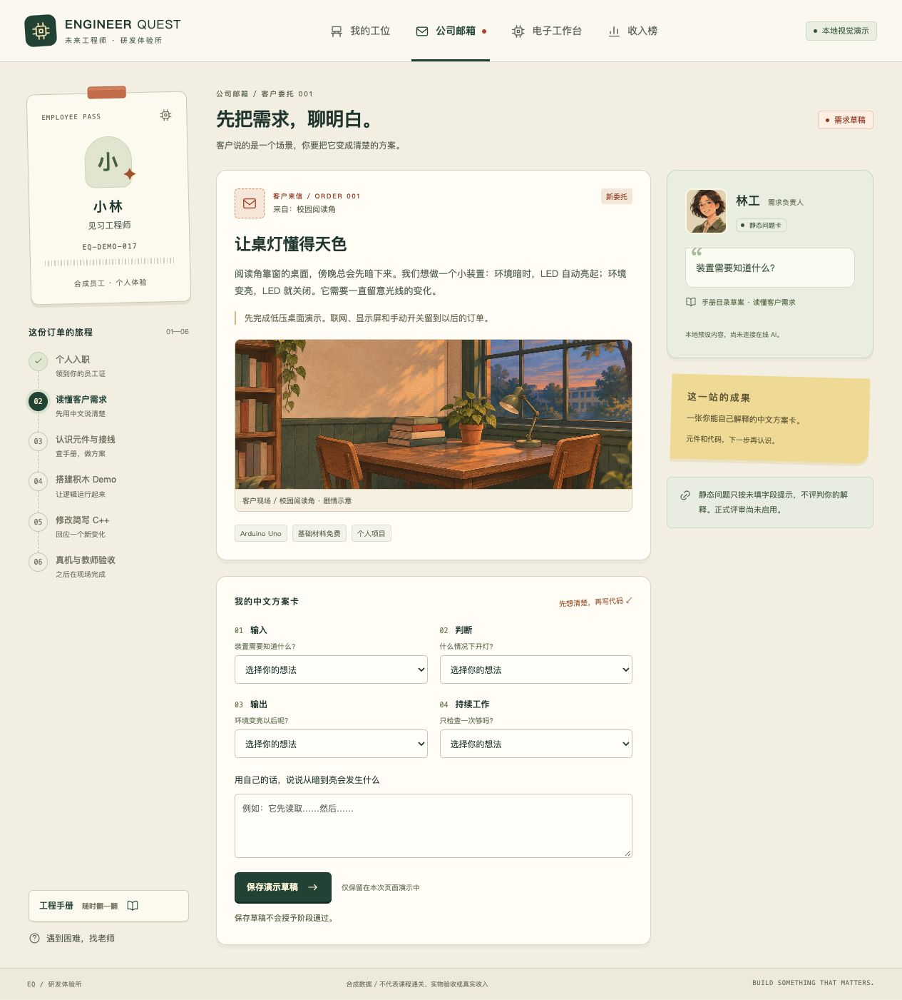
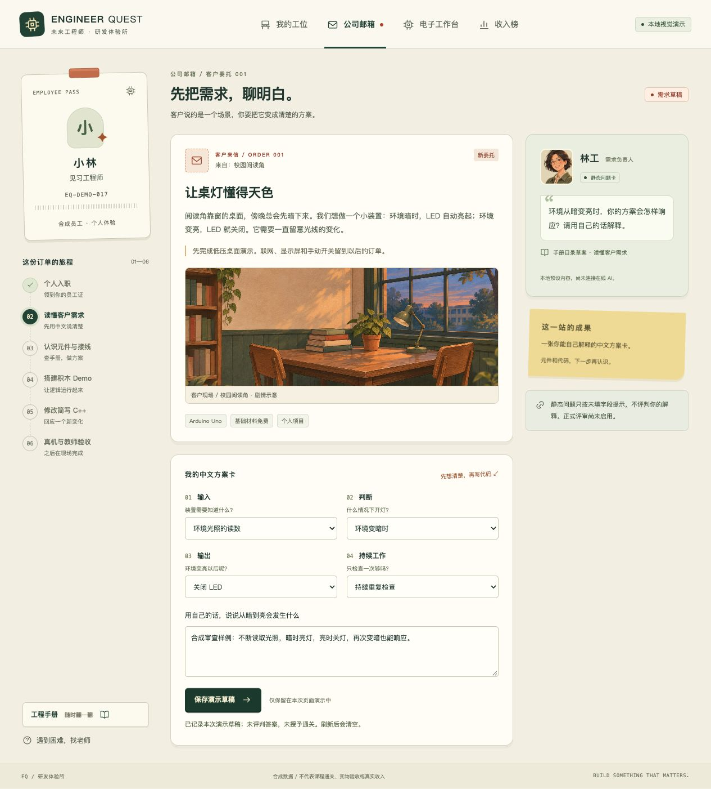
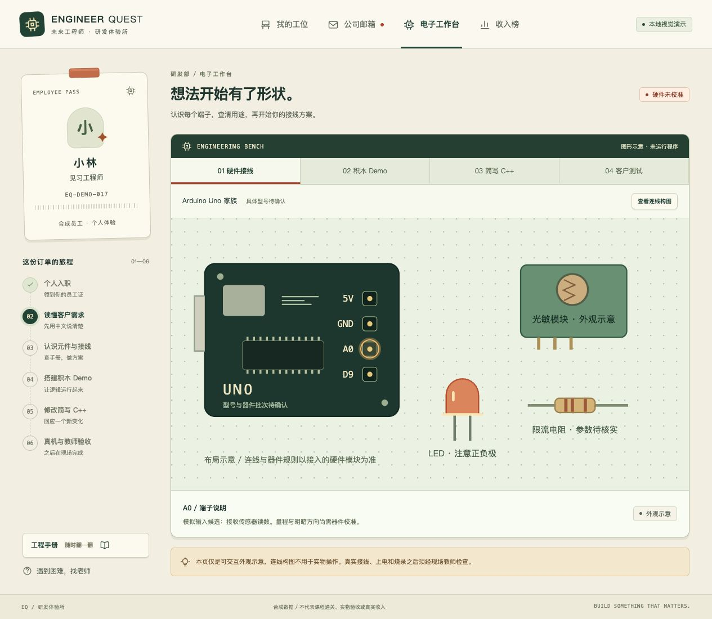
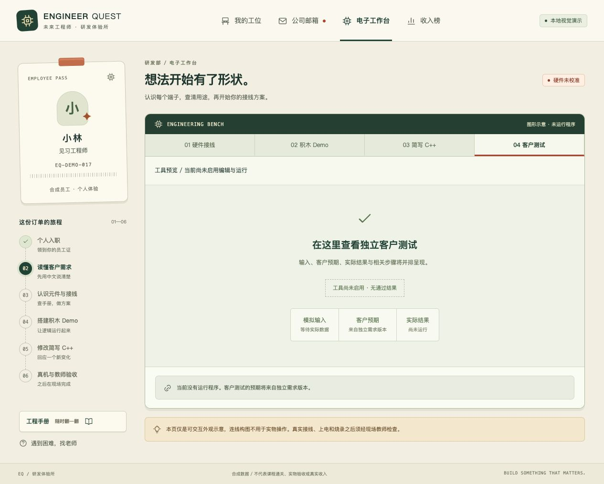
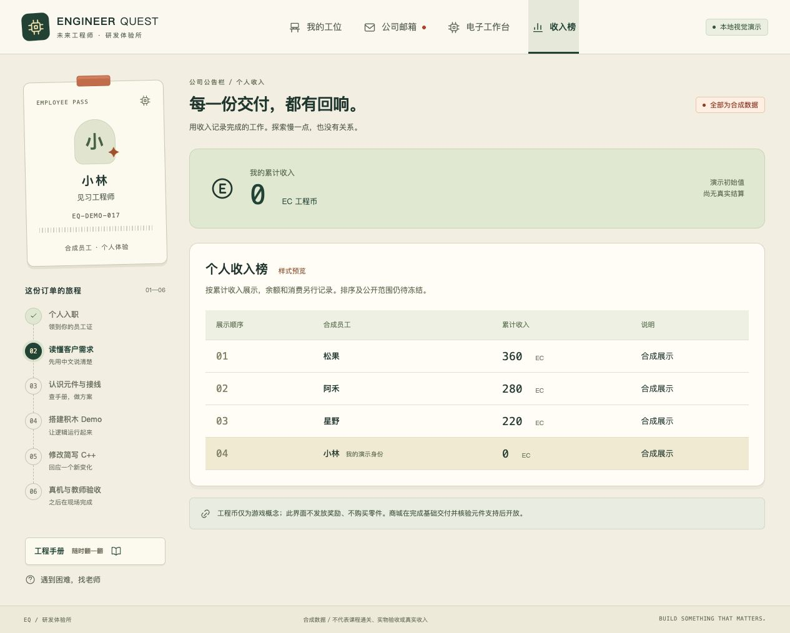
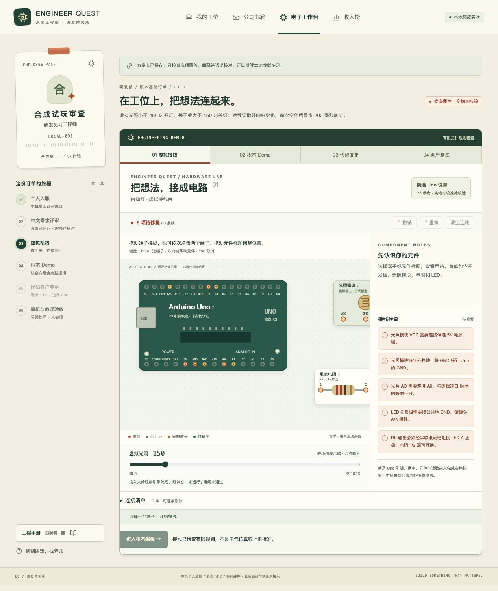

# 游戏性审查证据索引

2026-11-11 当前走查原件。九张截图均通过内置浏览器当次捕获、保存、打开检查；宽度为 1265px，整页高度按内容变化。只使用合成昵称与解释。`manifest.json` 记录源表面、文件时间、尺寸和 SHA-256；没有改写截图或用生成图替代界面证据。

前六步为 C 的独立视觉小样，后三步为 E 实际主入口。两种表面的限制分开记录。UI 后续修改不反映在这些冻结截图中，应重新取证后验收。

## 1. 工位与首单入口：氛围清楚，探索有限

员工证、林工与暖色研发室建立了职业场景；大场景主要是插画，查看委托、邮箱卡、NPC 和工具箱同时争取注意。建议只突出当前目标，场景提供三处可跳过的有用探索。此步不证明学生动机或学习效果。

## 2. 客户委托与中文卡：可理解，页面偏长

客户用途与不做的功能说明清楚；场景大图和完整表单形成较长页面。建议场景变化与一个问题先行，精确规则易查可见，保持当前操作入口。截图不能证明小字在课堂投影下可读。

## 3. 演示草稿保存：反馈诚实，衔接受小样范围限制

实际填入四项和合成解释后保存，看到“未评判答案，未授予通关，刷新清空”。这是独立展示页的实现范围；E 主流程的保存与继续已在步骤 8 单独核对，不能据此声称主入口断链。

## 4. 元件用途查看：有局部反馈，尚非操作闭环

实际点选 A0 后，端子高亮和说明同步改变，说明“模拟输入候选、待校准”。可沿用这种局部可见回响；这里没有拖线、运行或真实校准，不能评价实际 B 模块的完整操作。

## 5. 测试空态：旧小样的成功符号有歧义

文字准确说明未运行，标题上方的大勾仍可能被误认通过。已反馈 C；C 随后回报换成中性观察图标，待新增提交回归。本原件保留修复前事实，不代表 E 主流程也有此问题。

## 6. 收入榜：口径明确，成长证据尚薄

明确写出合成收入与余额分开，未伪装真实账本。页面主要展示数字，建议保留收入榜，同时用工作档案说明学生做过什么。未测试实际账本结算，也不能据截图判断榜单会激励或打击哪类学生。

## 7. 主入口个人入职：功能可用，当前动作可再聚焦

实际以合成昵称领取员工证并进入邮箱，受控个人状态发生改变；真实账号、编译烧录边界可见。场景上的“查看委托”和下方“领取员工证”并存，建议按当前阶段只突出一个动作；没有实测点击未入职时的场景按钮，不把可能混淆当作已证实绕过。

## 8. 主入口方案保存：可继续且待核对，引用需要人能读懂

实际领取订单、填卡保存；显示“解释待语义核对”，继续虚拟实验按钮可用，版本摘要可见。NPC 引用露出长技术 ID；建议默认显示当前需求与手册节号，将原始 ID/摘要放进详情。E 已接手此改动，待其浏览器回归。

## 9. 主入口空白接线：模块已接入，起步反馈与视野待改善

真实 B 工作台可进入，提供端子、撤销/重做与输入滑块；灯状态准确标记未运行。0 条线即“5项待修复”，初始错误色偏重；当前嵌套宽度下光照模块被裁、LED 不在初始视野。建议中性待连接、容器适配、全景或元件定位。E 已将增量交回 B；未在本次审查中完成接线与后续程序，不宣称完整游戏闭环已由 D 再验收。

