# 图形化 G0–G3 独立体验验收（2026-11-12）

修复候选5234的G0–G3与完整首单软件闭环已实际走通，G2原移动问题复验通过。可邀请小范围、有人观察的本机体验以继续收集反馈；不应据此宣布无引导新手体验或正式教学已经合格。后半程仍有自动对话遮结果、语句吸附与失败说明不足等非阻断问题。旧候选5232发现与新候选5234结果在下文分开。

本报告由未参与实现的独立体验 agent 依据可见界面操作。全部应用动作使用 CUA；仅报告、截图和清单使用文件工具。未读产品实现、测试、答案、存档，未加载整例，未用隐藏 setter 或脚本生成作品。体验者模拟首次接触嵌入式的学生，但不是真实学生试教，不能据此宣称适合教学。后续复验有此前体验经验，不能重新称作完全无先验的新手。

## 固定旧候选 5232：独立首轮

- URL：http://127.0.0.1:5232/，仅在此候选进行本节应用动作，未访问 5230。
- 页面“查看候选版本”核对：dialogue-e04531f1d59c；模式 frozen-candidate。
- 源码提交：bcb2ae3c696dc88d14e538b459679f33da5be413。
- 页面内容 SHA256：e04531f1d59cf26ac2b98e4e4a759c5e3ace4391eccc6533a4f70f8523527bd4，页面显示构建相关文件与提交一致。
- 入职前界面“新员工／等待入职／尚未建立本机档案”；合成昵称“蒲公英新手”，0 EC。没有使用旧档。

### 实际路线与观察

1. 入职逐句对话→收信→领取校园自动灯委托→六个客户情境。亲手遮光850→150；故意选择“开机时的旧便签”，收到“日期和旧读数无法区分这次从窗边到阴影的变化”，点击重试改选当前光照。随后依客户用途完成暗开、亮关、持续重读、450边界及620/430/450/200迁移情境。此段是需求情境，不混称图形G0。
2. 根据导师逐条点端子，完成六条虚拟线路；规则通过后点击到程序台。
3. 图形 G0：先看遮光演示，再亲手改变环境820→170，选择当前光照为输入、灯的开关为输出。未执行时仍标“尚未执行”；环境变化没有自动冒充灯执行。
4. G1：先预测true的结果、看导师轨迹；实际拖true到LAMP指令值位，成功吸附，灯仍灭。预测亮后执行，收到本人执行开灯记录。改false后旧灯结果标“修改前记录”，执行才灭。独立小任务又亲手改值并执行开、关各一次，均有0ms输出记录。
5. G2：预测无等待的开→关最终灭，导师轨迹为0ms开、0ms关。加等待步骤首次进入却残留“已经接上”提示，实际等待仍在托盘。尝试拖等待到两句之间，反馈却显示“尚未接上”；当时我被反馈引导，以为留下了游离等待。整理时重看原截图06，画面实际上是等待已排在首个灯指令之前，和两句灯指令连成一串，位置错误且反馈与画面不一致。我先用托盘点选又加了一块，发现重复后撤销。再选“移动工作区已有积木／等待”→“灯的指令·后面（插在下一句前）”，预览被拒绝为“这里接下一句动作；提供数值的积木要接到值位”。画面所选确为等待语句，并非数字。已即时报告并保存现场。最后撤销这次错放，改用托盘等待→预览→确认，再点选600接值位，得到开→等待600→关。
6. G2恢复：在上述作品执行前暂停；刷新后仍是“教学已暂停”。返回研发室，员工菜单“保存并返回员工选择”，再选同一员工、继续当前工作、继续这一步，仍在G2，同一开→等待600→关作品完整。撤销历史未跨刷新保留，不影响作品恢复；未将其当作已承诺行为。
7. G2执行：实际轨迹0ms开、0ms等待600、600ms等待结束及关灯。初始回放300ms灯亮；点等待记录、播放回放后末尾灯灭。按钮实为“播放回放／暂停回放”，主标题与导师说明持续标注回放，能与真实程序暂停区分。播放结束仍留在结果页，必须主动点底部按钮才继续。
8. G2独立任务“先保持关一会儿，再开”：尝试将末尾关灯块拖到前面也未吸附，撤销后使用已学过的字段改值，把首句改false、末句改true，预测亮并运行。轨迹0ms关、等待600、600ms开，任务接受。本轮完成的是行为顺序调整；没有把失败的实体积木重排称为成功。
9. G3：查看本步短图解P09，仅讲读取块值凸口、环境与旧采样、主动执行。实际拖LIGHT读取到观察值位成功。先保留导师170采样，移开遮挡后环境820而旧采样170；执行读取才变成本人820与0ms读到820，点击指认。再次独立把环境数值改333，旧采样仍820，执行后采样333与真实读取事件，完成G3。
10. G3后主动接回完整原型：导师明确回到完整原型工位。只查当前§07.1最小读取局部图解，实际拖入程序入口、在变量区接light整数声明，再用精确槽位接数字0初值。当前停在导师要求“持续执行接变量light设为”。实现方随后通知另冻修复候选并要求转版，故旧版在此保留现场；并非后半程遇到不可解的技术阻断。

### 可理解性与显示

- 实际看过1280×720图形G0/G2/G3、1024×768的G1搭建主画面、1440×900的G2主画面。三个尺寸下关键文字、积木托盘、目标、执行按钮及反馈同时可见，未见操作落点被导师文字遮住。主金色框在当前操作区，内部连接口另有金色目标；其余暗化帮助减少抢焦点。
- 大角色在左、样机在右，桌边带教布局自然，阅读时操作区位于中间。灯罩发光与台面照亮有对应实际输出记录；图片变化本身未作为执行证据。
- 1024×768仍能完整操作G1，未验证手机完整搭建。1440×900有较多工作区空白，但不妨碍本轮操作。
- 拖true与LIGHT值块两次成功；等待第一次实际落在首句之前，页面却报尚未接上；实体重排另一次尝试未吸附。说明拖拽与反馈体验不能一概宣布通过，点选预览确实提供了一条可用退路，但已有等待移动错误需修复。
- G2首次提示“已经接上”与G3初入残留“已撤销一步”不是当步动作反馈，可能让新手误以为自己已完成连接。
- G0–G3所观察结果均需主动继续；未见自动离开结果。暂停/刷新/返回/退出重进的组合恢复已实际完成一次，未声称每个阶段每个子步都覆盖。

### 结论与边界

| 项目 | 旧候选实际结论 |
| --- | --- |
| 图形G0观察 | 通过本轮体验 |
| G1开、关与独立任务 | 通过本轮体验 |
| G2顺序和等待概念及执行 | 通过可见撤销、托盘点选与字段修改完成；已有等待移动错误及阶段残留反馈不通过 |
| G3主动读取、旧采样区分、再次独立练习 | 通过本轮体验 |
| 三尺寸主要教学画面 | 本轮覆盖画面通过；非全站/手机覆盖 |
| 暂停、刷新、返回、保存退出再入 | 在G2同一现场组合恢复通过 |
| 首单后半程、基础/变更客户测试、失败修正、交付收入、便签恢复 | 已进入并搭三项，尚未完成，其余未覆盖 |
| 整套首单合格/可以邀请真实学生试教 | 旧版不作通过结论；不能以G3结束代替整套验收 |

本轮未运行自动化测试，也不引用实现方测试数量。没有读取完整答案或教师救援，没有加载整例，没有向真实设备上电。后半程既有流程不称作新G4已实现。

### 旧候选证据

证据目录：`evidence/graphic-intro-independent/`。逐文件URL、尺寸、字节数和SHA256在[旧候选manifest](evidence/graphic-intro-independent/manifest-e04531f1d59c.json)。所有旧证据文件均带e04531f1d59c前缀。

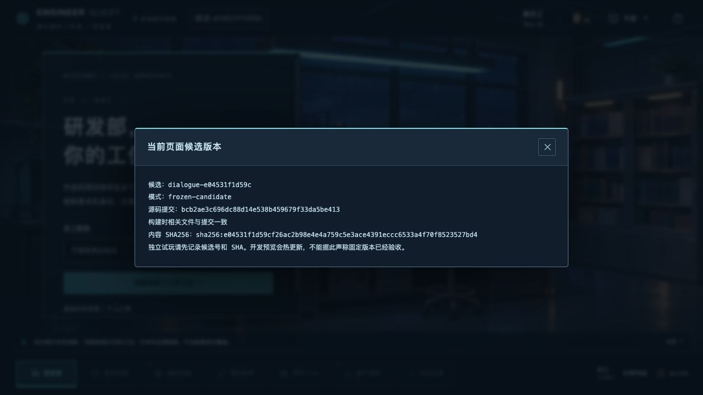

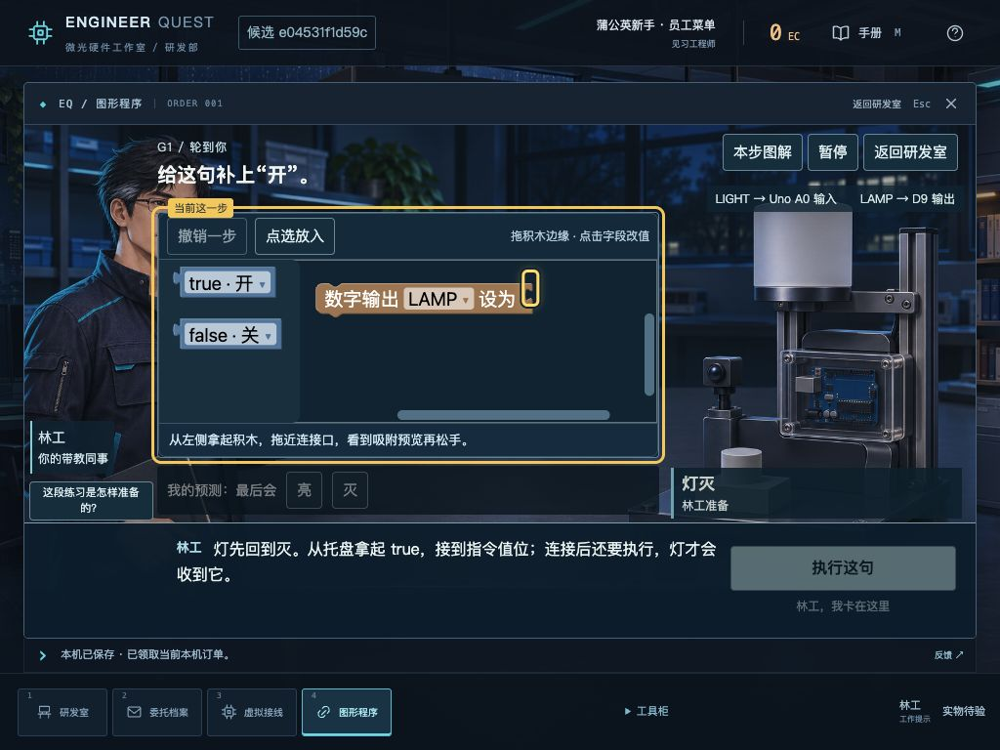

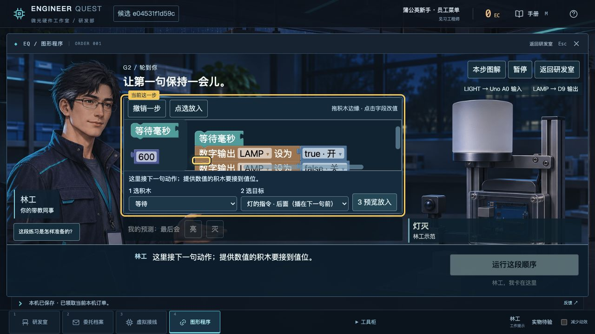

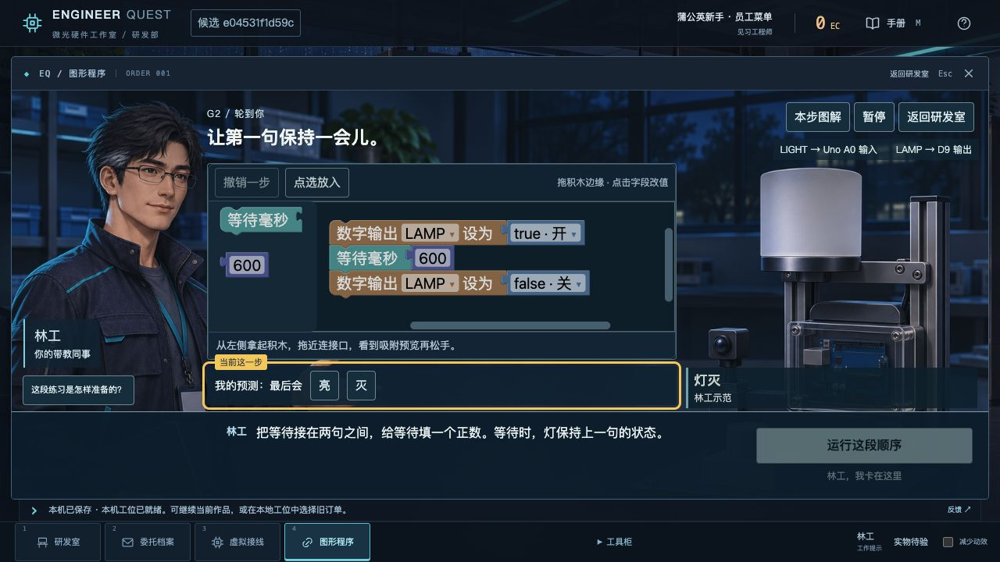

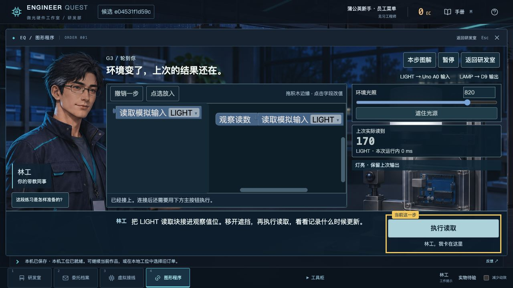

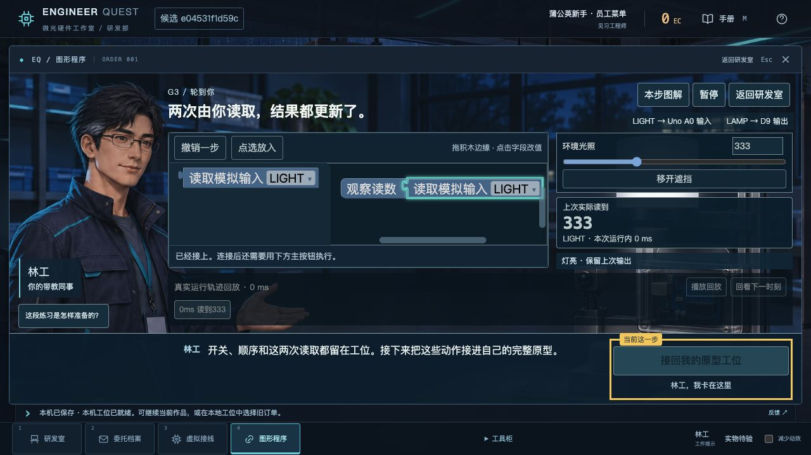

## 固定修复候选 5234：实际复验与完整首单

- URL：http://127.0.0.1:5234/，由主 agent 后续明确指定转入，未对5232服务进行修改。
- 页面“查看候选版本”核对：dialogue-b162dbaedb5a；模式 frozen-candidate。
- 源码提交：ceeb1817170db40e0de355d5a76a5d4d3c82b830。
- 页面内容 SHA256：b162dbaedb5ab2e57cc59bac90529e941ba74a32155918525dd1b48d9eebf0ff，页面显示构建相关文件与提交一致。
- 入口重新显示新员工、尚未建立本机档案。合成昵称“青禾复验生”，从0 EC入职。5234是全新员工/作品，但体验者已经做过5232，不能冒称没有前版操作经验。

### G0–G3复验的实际过程

1. 重新走入职对话、首单六个客户情境与六条虚拟接线，没有搬运旧版作品。
2. G0重新看演示并亲手遮光，选择当前光照与灯开关，确认输入输出。环境变化仍标尚未执行。
3. G1在1024×768实际拖true到值槽成功。预测、执行开灯；改false、预测并执行关灯。独立任务再完成开与关各一次。修改后旧记录仍有“修改前记录”，执行来源区分林工示范/本人执行。
4. G2进入加等待时，提示已变成“把等待接在两句之间，再接上毫秒数。抓住实心边缘拖动，看到吸附预览再松手。”不再残留G1的“已经接上”。本轮等待拖放实际吸附成功。
5. **明确复验原修正路径**：用可见点选把工作区已有等待故意移动到首句灯指令之前，给它接600，预测灭并运行。页面停在“沿着刚才的顺序找原因”，显示“这一段从一条灯输出开始，把后续动作接在它下面”“本次尚未执行”。再选同一“工作区已有等待”→“灯的指令·后面（插在下一句前）”，预览和确认均成功，恢复开→等待600→关，未再把等待误判成提供数值的积木。撤销一次又恢复首句前错序，随后再次移动同块修正成功。原错误不是靠多放新块或改值绕过。
6. 修正后运行轨迹为0ms开、0ms等待600、600ms等待结束/关。停在300ms回放灯亮。实际点等待事件、播放，按钮显示“暂停回放”，结束仍留本步结果，需主动继续。
7. 在本人运行后的300ms结果处暂停→刷新→返回研发室→保存退出员工选择→重进同员工→继续。恢复同一G2步骤、同一开等待关作品及300ms回放位置。原撤销操作在刷新前已经实际验证。
8. G2独立任务这次使用可见点选真正重排实体语句：末句关移到第一句前，再把已有等待移到首句后，得到关→等待600→开。预测亮并运行，记录显示0ms关、等待600、600ms开。没有借用旧版通过字段改值完成的路径。
9. G3入场不再残留旧撤销反馈，实际拖LIGHT读取块到观察值位成功。环境由170变820时旧采样仍170；执行后得到本人820并指认。第二次独立把环境调412，旧采样820保持，执行才更新为412与0ms读取事件。主动接回完整原型。

### 后半程既有首单回归：从空原型到交付

这是既有完整原型工位回归，**不是声称新G4或之后课程已实现**。

1. 只读当前局部§07.1图解，手动拖入入口、light整数声明、初值0；持续执行接light赋值及读取LIGHT，再接等待100。精确槽位帮助锁定各个值槽。运行一次后成功自动弹出“让读数作决定”的全屏导师对话；继续后，原150读取事件仍可在观察区和“上一次实际操作”回看。
2. 查当前§07.2局部图解，亲手搭light < 450判断。把如果块插到读取与已有等待之间多次没接上，导师指“散落动作”；精确槽位只有值槽，没有语句插入位。通过重新定位，把如果先接在等待后方才能继续；各值块采用可见精确槽位逐个拖入。这里没有隐藏setter、自动构建或加载整例。
3. **实际失败与修正一**：故意先只接暗侧true，不接否则输出。150观察有开灯事件；850最终灭却标待排查，展开记录只有读取和分支，没有写出。这能揭示“默认灭”与“明确关灯”的区别。补上否则LAMP false后，重新运行暗、亮场景，均记录通过。
4. **实际失败与修正二**：读取→等待100→判断的连续暗亮暗练习未通过，末尾虽然亮，事件是100ms才第一次开灯、200ms关、300ms再开；页面仅笼统写“本次未取得该步所需观察”。求助只说重新读、重新判断、看右侧时间，未说明这组事件为何不满足本步。我根据已经看过的局部图解怀疑等待位置，亲手将判断段暂时移出，再移开原等待；重新接读取→判断→原等待100。实际再次运行通过，开关事件出现在0、100、200ms。这里只报告可见前后结果，不推断隐藏判定器；原公开需求允许最多200ms响应，因此失败提示应明确说明具体不足，不能只让学生猜。
5. 修改后页面要求复核受影响的旧观察，基础测试按钮暂禁用。实际依次复核读取、两个分支、连续变化后解锁。点击运行当前基础客户测试，通过；后续历史确认需求1.0.0/测试集1.0.0，**26/26，4个固定场景**，含449/450/451边界和重新读取。成功时又自动弹客户第一封回信。
6. 新来信把边界450改600。实际完成500应亮、600等于应灭、指认本人“运算 <”对应短代码、旧回信不能代替新测试四个迁移情境。该页展示的是我刚搭出的基础作品生成代码，未读预置完整答案。
7. **实际客户测试失败与修正**：在短代码仍为light < 450时，故意点击“运行当前变更客户测试”，得到需求1.1.0/测试集1.1.0 **12/20失败**，选中“新旧需求区别：500应亮”，200ms等采样明确期望亮、实际灭。交付和导出按钮禁用。我转到底部专用“6客户测试”查看完整表格，保留失败截图。
8. 回代码页，用可见文本选择只选450并键入600，没有粘贴整段程序。点“检查当前代码”，再运行变更客户测试；通过后弹交付对话。交付后回测试台核对**20/20，3个独立场景**；原暗亮功能、新旧500差别、599/600/601新边界均符合。全部本机历史仍保留基础26/26、旧代码12/20失败（标历史/证据已失效）和当前20/20。
9. 点击导师“交付这版软件演示”，到交付回信页，**100 EC**。写入本人真实过程工程便签，等“本机已保存”后刷新；便签、收入、交付状态恢复。回看当前短代码仍600，原基础积木仍450且等待在判断之后，原观察也保留；没有把短代码强行覆盖回旧积木。
10. 在同订单再次点击交付，收入仍100 EC，便签保留。再回研发室、保存退出到员工选择、选择青禾复验生、打开交付记录，仍显示100 EC与同一便签。结束时恢复viewport默认值，保留最终交付页并按规范完成CUA收尾。

### 显示、提示和工具发现性

实际查看的新教学尺寸为1280×720、1024×768、1440×900，以及补充3440×1157。前三项覆盖G0/G1/G2/G3主要教学画面；3440画面实际查看的是G2本人轨迹和后半程初始完整工位。不是全站每页每尺寸穷举。

- 金色主焦点与其余暗化在G0–G3能帮助判断当前该动哪里；内部目标口的金色轮廓进一步指向落点。大角色和样机布局自然，未见导师文字挡住本轮落点、字段或主按钮。当前步骤结果主按钮与说明可见。
- 新教学3440×1157使用居中场景，两侧留白，角色、装置和操作区没有分散到屏幕两端。后半程完整工位则展开到全宽，左提示与右结果相距较远；工具栏和底部“客户测试”等文字仍可发现，实际通过它们完成回看。
- G0–G3结果都留在本步，必须主动继续。回放有“真实运行轨迹回放”“播放回放/暂停回放”“当前回放xx ms”的明确语义，没有误导我认为它在真暂停/继续控制程序。图片亮暗只作表现，判断以实际读取/写出事件和客户期望/实际采样为依据。
- 后半程成功触发自动全屏对话，实际发生在最小读取成功、明暗分支齐全、基础客户测试成功、变更测试成功。此时结果暂被遮住；继续后仍能回看记录。这不满足“整套结果必须主动继续后才离开”的体验要求，不能拿新G0–G3的主动继续机制掩盖。
- 后半程语句吸附比值块更费力。如果插入、分支输出等多次首次没接上；散落积木会把可运行观察锁住，提示能指出散落但缺少可点选的语句目标。最后通过可见拖放重排恢复，未丢作品，也未求实现者提供搭建答案。
- 1280代码页右侧测试结果约220px宽，场景选择和表格横向挤压，需要横向/纵向滚动；专用“6客户测试”是完整宽度，期望/实际/结果清楚。实际转过去才方便核对失败，建议代码页主动提供该入口。
- 短代码改600后，左侧所选基础积木解释仍显示(light < 450)，当前代码显示600。原作品保留是正确行为，但该处最好直接标“保留的基础积木”，减少被当作当前表达式的可能。

### 独立判断：阻断与邀请体验

| 范围 | 修复候选实际结论 |
| --- | --- |
| 新图形G0–G3主流程、本人开关/顺序/两次读取 | 本轮通过；实际操作完成，不以测试套件代替体验 |
| G2原错放等待移动错误、撤销、阶段残留反馈 | 本轮明确路径复验通过 |
| G0–G3主画面、焦点、回放语义、结果主动继续 | 覆盖画面通过 |
| G2暂停/刷新/返回/退出重进恢复 | 同一作品、步骤与300ms回放位置恢复通过 |
| 完整首单衔接、基础/变更客户测试、失败修正、交付收入 | 本人从空搭建并走通，功能回归通过 |
| 便签刷新、保存退出重进、原积木/600代码、失败历史保留 | 本轮通过；同单再交付不重复发收入 |
| 后半程结果全部等主动继续才离开 | 不通过：成功自动弹全屏对话遮住结果，记录可回看 |
| 后半程无引导的新手自学便利性 | 暂不能宣布合格：语句吸附多次尝试，连续练习失败原因不够具体 |

本轮没有不可恢复的实质阻断：全部关键作品与测试都能通过可见UI修正，完整首单最终完成。上述自动对话、语句落点/失败说明和侧栏布局属于**非阻断但真实影响学习判断与操作负担**的问题，其中语句吸附与失败理由不足优先处理。

**可以邀请小范围、有人观察的本机软件体验**，用于收集真实学生反馈；应提前说明这还是包含既有原型后半程的体验版。**不宜以此宣布整套无陪同新手体验已合格、正式教学已验证或新G4已完成。** 这个判断依据本人完整走通与可恢复性，不依据26/26、20/20等游戏内断言数字单独作教学适配推论。

### 未覆盖与实际限制

没有真实学生参与；复验已有首轮经验。未验证手机完整搭建、每一个子步每种恢复组合、全站每个断点、导入导出档案、导出.ino、重做/从空再试、多员工隔离及真实硬件编译/烧录/上电。没有重置或删除任何用户数据，没有提交、push或部署，没有运行工程自动化测试。所有26/26、12/20、20/20均来自本人实际点击游戏内客户测试后的可见结果，不是实现方提供的测试数量。

### 修复候选证据与清单

[新版manifest](evidence/graphic-intro-independent/manifest-b162dbaedb5a.json)记录每张图候选、URL、实际尺寸、字节、SHA256；[合并manifest](evidence/graphic-intro-independent/manifest.json)和[截图索引](evidence/graphic-intro-independent/README.md)汇总两版。旧前缀e045与新前缀b162没有混写。

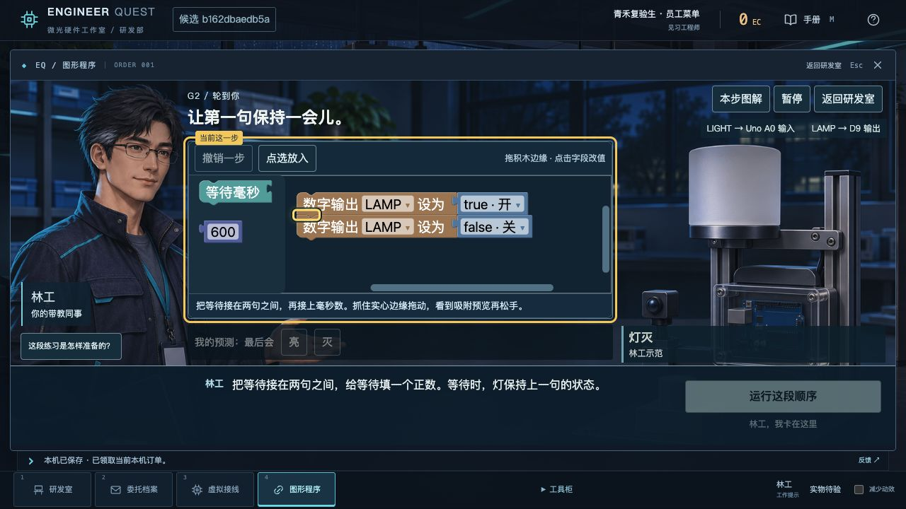

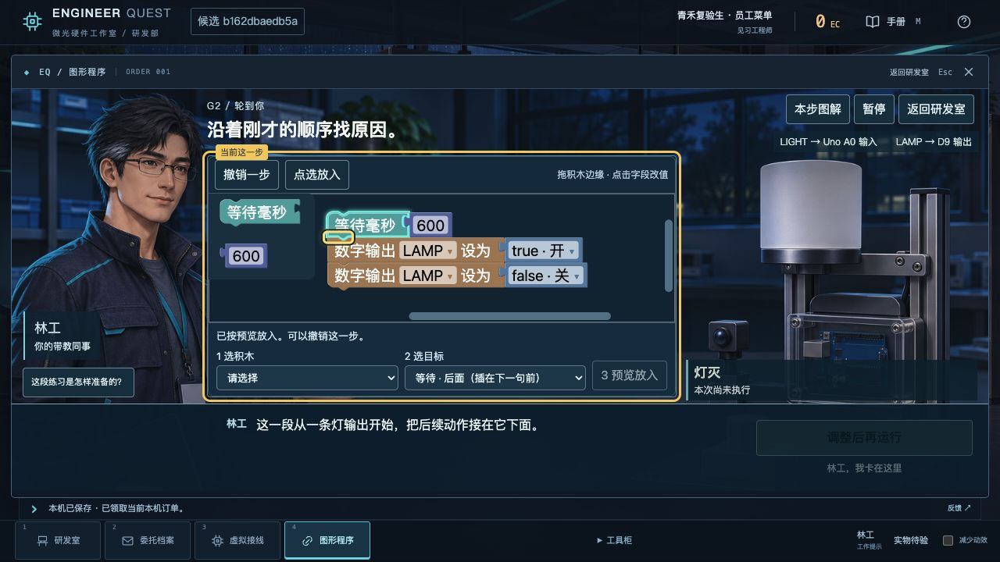

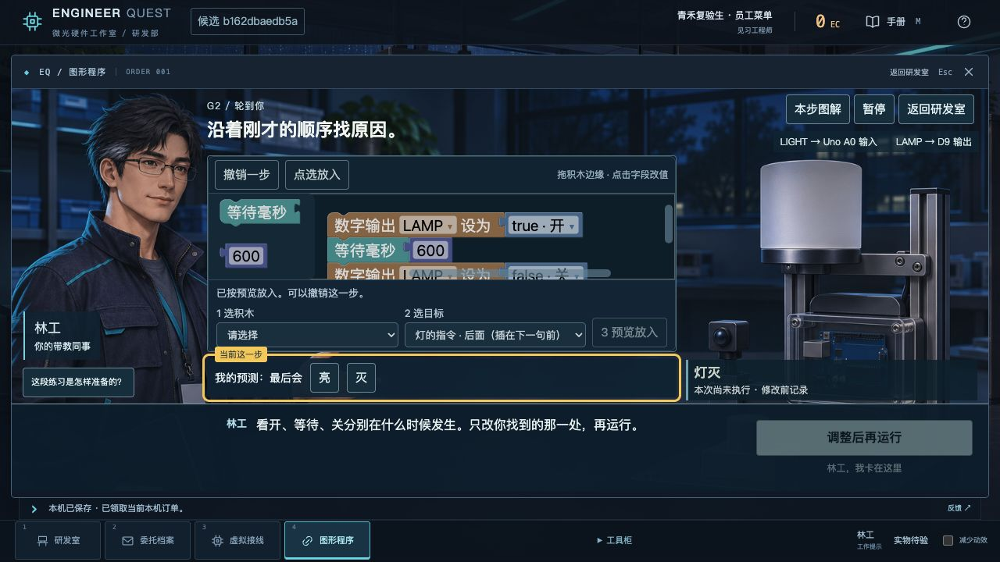

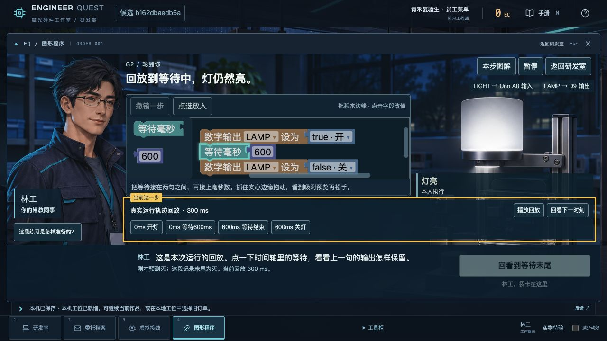

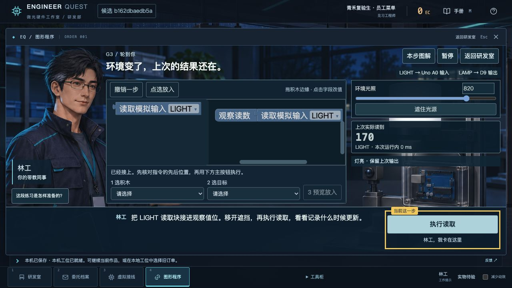

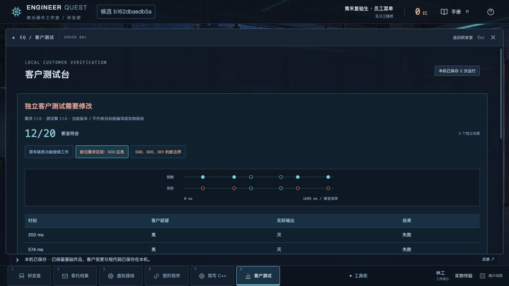

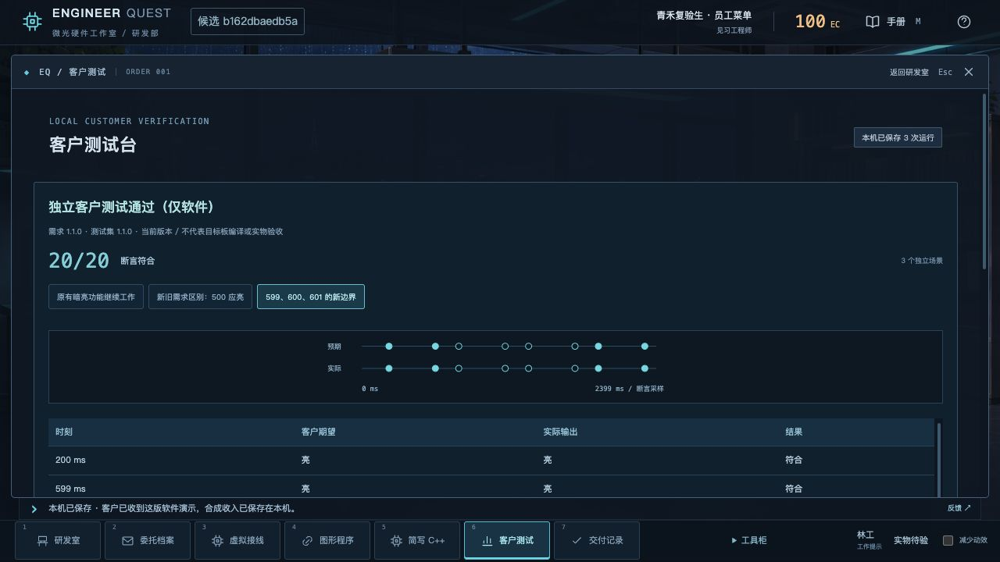

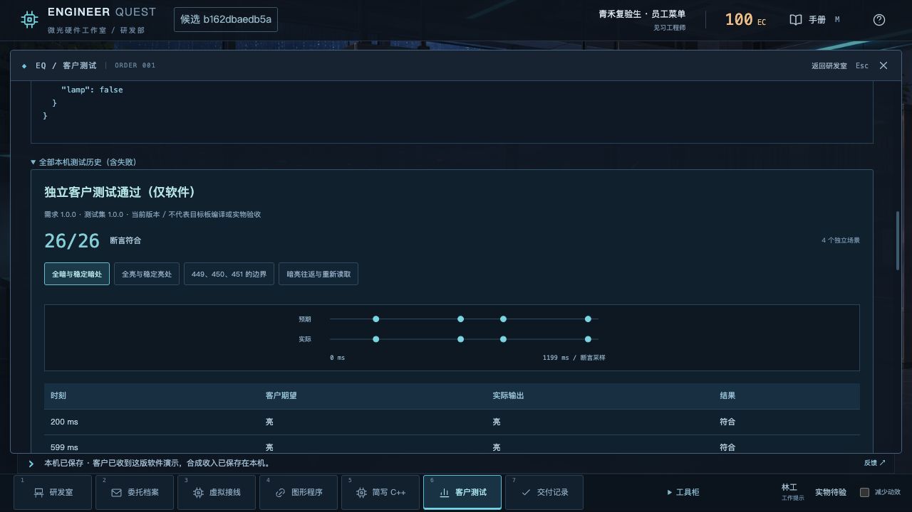

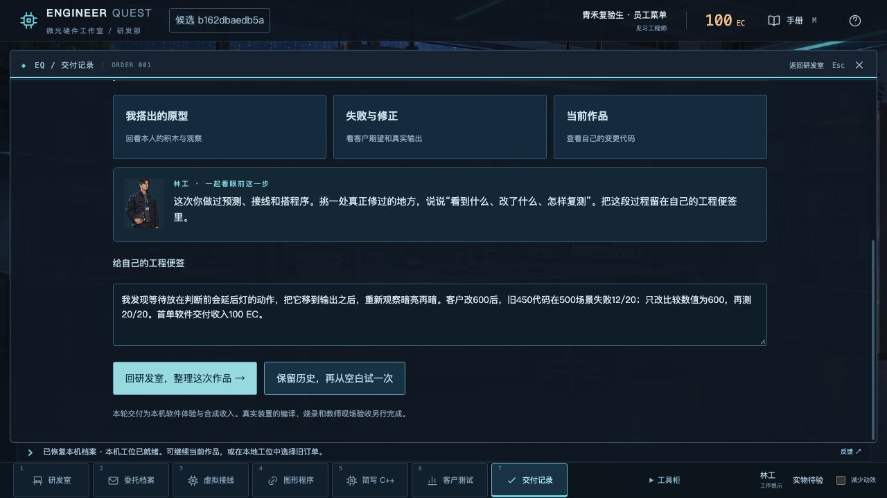

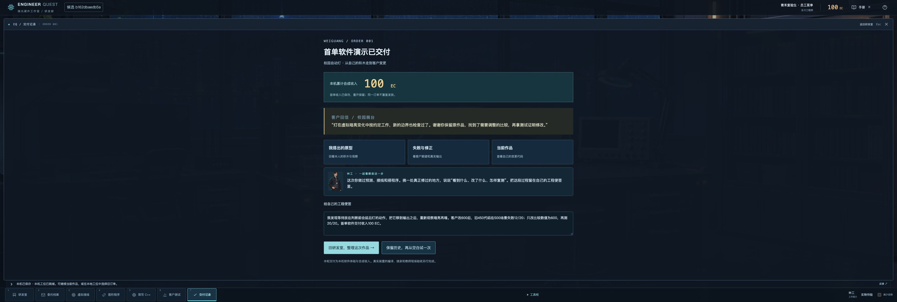
