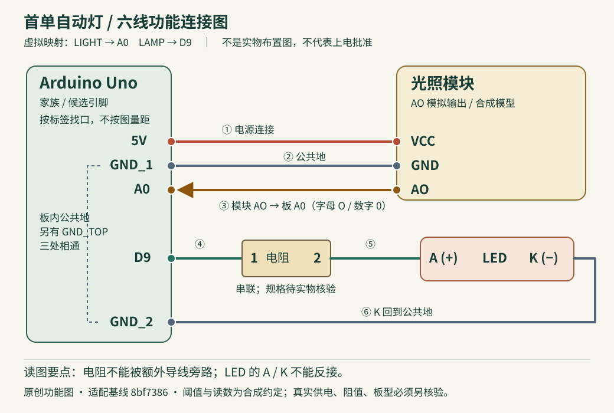

# 首单工程手册：给展台做一盏自动灯

**学生操作册 V0.2 · 本机软件体验 · 2026-11-11**

你是一名独立负责订单的见习工程师。客户需要的不是“某一次能亮”的灯，而是能随着环境反复变化、并按约定及时响应的灯。你要留下自己的方案、接线、程序与测试记录。遇到困难可以查资料、使用提示或请教师帮助，不需要独自硬撑。

本册配合研发室中的实际工具使用。点击“手册”可以读本册、按节号查看[工程参考](工程参考.md)，并在需要核对时进入完整参考实现。林工提供本地脚本带教与真实状态提示，不是在线 AI；对话不会代替你的作答、接线、练习或测试。

## 路线图

| 工位 | 你做什么 | 到哪一步才继续 |
|---|---|---|
| [1 接单](#t1) | 读需求，逐个判断六个具体情境 | 当前六个情境完成；自由解释不自动评分 |
| [2 接线](#t2) | 认端子，手动连六根线 | 显示“接线规则通过” |
| [3 设计](#t3) | 预测边界，画每轮工作的顺序 | 说清读取、分支、输出、等待 |
| [4 积木](#t4) | 输出引导、最小读取、双分支、重复读取，再提交作品 | 当前学习观察与基础客户测试均就绪 |
| [5 变更](#t5) | 预测变更，找自己积木对应代码，修改后复测 | 变更情境、代码映射与新版测试均就绪 |
| [6 交付记录](#t6) | 导出源码，记录软件结果 | 不把软件通过说成实物通过 |
| [7 排错与复盘](#t7) | 留下失败、假设和复测 | 能解释一次修改的依据 |

### 开始前

- 打开教师给出的**应用主页**，不是 `/legacy.html`，也不是独立 `demo.html`。本册不假定部署网址或端口。
- 建议电脑浏览器操作。接线全景可缩放，但积木仍需要拖拽空间。
- 本单是**虚拟低压 LED 演示**，不涉及市电。不要拿网页示意直接给实物接电。
- 本机草稿通常自动保存，但并非云账号或跨设备存档。不要在练习中随意清除浏览器数据。重要节点自己保留截图、短代码和记录。
- 页面显示“本机已保存”后，昵称、当前订单、原始回答、接线、积木、短代码、实际观察、失败/成功测试和合成收入一起保存在当前浏览器。刷新会重新核对记录；版本变化时旧证据保留为历史，不冒充当前通过。见[§01.1](工程参考.md#s011)。

<a id="t1"></a>
## 1　接单：先把“暗了就亮”说清楚

### 1.1 操作

1. 填写昵称，不需要真实姓名，点击 **“领取本机个人员工证 →”**。已有本机作品会恢复，不需要重新入职。
2. 点击通信终端或底部“委托档案”，再点 **“向林工领取订单 →”**。场景热点和林工说明都可随时关闭，不是通过条件。
3. 阅读客户原文及基础需求。每次只观察当前情境，先不要打开完整答案附录。
4. 跟林工走到当前场景，可移动遮挡或逐个推进客户序列。点击桌面上你想演示的动作卡；林工会回应这次判断。听完可点“和林工继续看下一处”，不确定就留在这一幕再观察。六个场景分别涉及当前输入、暗亮动作、再次变化、严格等值边界和另一组输入的预测。
5. 不确定时选“不确定”或点 **“林工，我需要一个小观察”**。看具体原因和小观察，再回当前题重选；求助不扣资格。在“把我的疑问告诉林工”展开的选填“想法或困难”保留原话，不会被自动判成理解正确。
6. 前四项完成仍需核对边界和迁移题。答错时停在对应题；不会只凭四个熟悉选项、随便写一句解释就让你通过。
7. 看到 **“和林工继续这份委托”** 后点 **“继续当前作品 →”**，进入虚拟接线。

这里核对明确的情境选择，不理解任意中文。有限的明确求助句只转入引导；未知自由文字不参与自动判对。**情境完成也不等于已经掌握全部知识、软件通过或实物安全。** 卡住时可现场请教师一起看。参见[§02.1](工程参考.md#s021)。

### 1.2 把订单贴在工位边上

| 基础需求 1.0.0 | 客户约定 |
|---|---|
| 输入 | 虚拟光照整数，0～1023，数值越小表示越暗 |
| 开灯条件 | 读数**严格小于 450** |
| 关灯条件 | 读数等于或大于 450 |
| 连续性 | 不断重新读取、判断、更新，不只在启动时判断一次 |
| 响应 | 每次光照变化后最多 200 ms，也就是 0.2 秒内作出相应输出 |
| 本次不做 | 按钮、屏幕、联网、市电灯、真实电气仿真、防闪烁滞回 |

这些数不是照度单位 lux，也不是实物已经校准的读数。它们是这张虚拟订单的明确规则。

**先写预测，再操作：** 读数为 150、450、850 时，灯分别应该怎样？如果先是 150，再变为 850，是否只需要“开灯”这一种动作？

<a id="t2"></a>
## 2　接线：让输入和输出各走自己的路

### 2.1 先找元件和端子

打开 **“01 虚拟接线”**。初始画布已经放好 Arduino Uno、光照模块、限流电阻、LED，但没有导线，显示“待连接”。不需要从商店购买，也不用拖入面包板。

1. 点击元件标题，读“接线资料与检查”里的用途。
2. 点击 **“放大接线”** 看清文字。需要时使用 **“← 向左查看”**、**“向右查看 →”**；点击 **“查看全景”** 回到整图。
3. 找出板上 `5V`、`GND`、`A0`、`D9`。`A0` 是字母 A 加数字零，不是 `AO`。模块 `AO` 的末位是字母 O，表示模拟输出。
4. 找出模块 `VCC/GND/AO`，电阻 `1/2`，LED `A +/K −`。同一个字母 A 在 `A0` 和 LED `A` 里不是同一用途。

如果只是点端子看资料，读完按 `Esc` 取消接线起点，再看下一个，避免顺手把两个端子连起来。板图是 R3 参考外形，不代表套件已经确定为 Uno R3。界面的“220 Ω · 候选”也不是实物采购或上电依据。查[§04.1](工程参考.md#s041)、[§05.2](工程参考.md#s052)。

### 2.2 读图



这是一张**功能连接图**，不是按实际针脚间距绘制的面包板图。导线只能连接到端子圆点，视觉交叉不是新端子；移动元件不会改变已连接的端子关系。

```text
Uno 5V ───────────────────────── 光照模块 VCC
Uno GND_1 ────────────────────── 光照模块 GND
Uno A0 ◀──────────────────────── 光照模块 AO

Uno D9 ── 电阻 1 ──[限流电阻]── 电阻 2 ── LED A(+) ──|>|── K(−) ── Uno GND_2

Uno 的 GND_TOP、GND_1、GND_2 在虚拟板内相通，画面都标成 GND。
```

图中的 `GND_1/GND_2` 是用于区分端子的内部名称，不要求实物板上印着这个后缀。

### 2.3 亲手连六根线

每条线都可以**依次点击起点圆点、终点圆点**；也可以按住起点圆点拖到终点圆点松手。先用点击法更容易核对。点错起点按 `Esc` 取消。按住元件**标题**拖动只改变位置，不是接线。

| 次序 | 起点 | 终点 | 连完后回答 |
|---|---|---|---|
| 1 | Uno `5V` | 光照模块 `VCC` | 哪根线给模块提供电源连接？ |
| 2 | Uno 下排靠近 `5V` 的第一个 `GND`，资料显示 `uno:GND_1` | 模块 `GND` | 为什么除了信号还要公共地？ |
| 3 | 模块 `AO` | Uno `A0` | 信号是从模块进入板，还是从板点亮模块？ |
| 4 | Uno `D9` | 电阻 `1` | 灯输出为什么不直接接 LED？ |
| 5 | 电阻 `2` | LED `A +` | 电阻有没有真的处在输出路径中？ |
| 6 | LED `K −` | Uno 下排第二个 `GND`，资料显示 `uno:GND_2` | LED 方向是否与图一致？ |

电阻 1、2 可以互换。三个 Uno GND 在本模型中等效；本册用两个下排 GND 只是为了清楚分开两条线。不要额外把 `5V` 和 GND 相连，不要给电阻旁边再加一条绕过去的线。

连接未齐时出现“待修复”很正常。连完展开 **“连接清单”**，逐条核对端点，而不是只数线数。删错线用该行 **“删除”**，不是点图上导线。工具栏 **“↶ 撤销”** 可恢复本次编辑；**“清空连线”** 会删除整套线，不用于单根修正。

### 2.4 检查点

- 显示 **“接线规则通过”**，无红色错误。
- `HARDWARE_UNVERIFIED` 所对应的“实物未核验”警告仍会存在，不需要靠改线消除它。
- 此时 LED 显示“未运行”不代表接错了，它还没有程序输出。
- 点击 **“进入积木编程 →”**。如果按钮不能点，先点具体错误卡，画布会定位相关端子。参见[§09.2 接线排错](工程参考.md#s092)。

**可选小练习：** 只在虚拟画布把 AO 暂接 A1，观察诊断，再撤销。说出“模拟口”与“这单指定的 A0”为什么不是同一个要求。不要在实物上复现错误线路。

<a id="t3"></a>
## 3　先设计一轮，再拖积木

在纸上画四个框：

```text
读取现在的光照 → 判断是否满足开灯条件 → 明确写入亮或灭 → 等一小会儿
       ↑_______________________________________________________|
```

“持续执行”会自动回到第一步，不必再套一个永远循环。读数放入一个变量，可以在这一轮重复查看同一份采样。边界放入常量，方便客户改变要求时只改一个地方。

先填写自己的设计卡：

| 项目 | 我的决定或解释 |
|---|---|
| 保存本轮光照的变量名 | ______ |
| 保存客户边界的常量名 | ______ |
| 比较符号为什么不能随便选 `≤`？ | ______ |
| 条件成立时的输出 / 不成立时的输出 | ______ / ______ |
| 等待放在两个分支之后，为什么？ | ______ |
| 每轮等待 100 ms，遇到刚读完就变化的输入，会怎样？ | ______ |

本册下面用 `light` 保存读数、`threshold` 保存边界。用别的名字也可以，但所有声明、读取和赋值必须一致。**`LIGHT` 是硬件逻辑输入端口，`light` 是你声明的变量，大小写不能混用。** 对照[§07.1](工程参考.md#s071)。

100 ms 是本教程方便观察的选择，不是客户要求的固定常数。客户要求的是响应不超过 200 ms。等待越长不一定越稳定，等待为 0 也不等于更好；本执行器需要时间前进，否则可能耗尽步数预算。

<a id="t4"></a>
## 4　从空白搭建：积木基础订单

### 4.1 认识工作区

打开 **“02 积木 Demo”**。左侧只有三类工具箱：**“变量与流程”“输入与判断”“输出”**。从类别里把积木拖到中间工作区，再把突起与凹槽连接。值积木嵌入表达式空槽，动作积木上下相接。

空白表示还没有开始，左侧显示当前一步及局部连接提示；主线没有一键加载完整答案。先点 **“让虚拟 LED 亮起来”**，观察实际写出的输出。这是隔离的引导实验，不会替你填入自动灯积木。随后搭建能读取的最小程序，再逐步加入判断与输出。需要救援时先保留自己的尝试，再查完整参考附录。

### 4.2 声明区：准备两个名字

1. 打开“变量与流程”，拖出 **“程序入口 / 变量 / 启动时 / 持续执行”** 大入口块。这是唯一程序入口，只保留一个。
2. 拖出 **“声明…类型…常量…初值…”**，接到入口的“变量”槽。点名称字段填 `threshold`，类型选“整数”，常量选“是”。
3. 打开“输入与判断”，把数字块拖入这个声明的“初值”空槽，填写基础需求边界。
4. 再拖一个声明块，**接在第一个声明块下方，仍位于变量槽内**。名称填 `light`，类型“整数”，常量“否”，初值嵌入数字 `0`。
5. 先停一下：`threshold` 是否为 `450`？`light` 初值 0 只是启动时的占位，不应替代后续重新读取。

“启动时”暂时留空是合法的。不要把读取放进声明初值；初值只接受数字或布尔字面量。

分步起步时也可以先只声明 `light`，在持续执行内连接“light 设为读取 LIGHT”与“等待 100”，然后点 **“运行一次，查看实际读取”**。观察中的读数应与选定光照一致。之后再加入 `threshold` 和下面的判断，不必起步就把整题一次搭完。

### 4.3 持续区：先读，再判断

1. 从“变量与流程”拖出 **“变量 light 设为…”**，接到入口“持续执行”槽。
2. 从“输入与判断”拖出 **“读取模拟输入 LIGHT”**，嵌入赋值块右侧空槽。下拉端口选 `LIGHT`。这个积木不是普通数字。
3. 从“变量与流程”拖出 **“如果…执行…否则…”**，接在赋值块下方。当前工具箱给出的判断块已经带“否则”；不需要新增“否则如果”。
4. 从“输入与判断”拖出两个值槽的比较块，嵌进“如果”的条件槽。下拉比较符号选 **`<`**。
5. 从“变量与流程”拖出 **“变量…的值”** 两块。第一块名称 `light`，嵌入比较左侧；第二块名称 `threshold`，嵌入右侧。

先用自己的话读一遍：“如果这一轮的 ______ 小于 ______，就走上面的执行分支，否则走下面的分支。”

### 4.4 输出区：两个分支都要有动作

1. 从“输出”拖出 **“数字输出 LAMP 设为…”**，放进“执行”槽，端口选 `LAMP`。
2. 从“输入与判断”拖出布尔块，嵌入其值槽，选 **`true`（真）**，表示开灯。不要放数字 `1`，布尔与整数不自动互换。
3. 再放一个输出块到“否则”槽，端口仍为 `LAMP`，嵌入 **`false`（假）**，表示关灯。当前布尔下拉实际显示英文 `true/false`。
4. 从“变量与流程”拖出 **“等待毫秒…”**，接在**整个如果块的下方**，仍在“持续执行”中。嵌入数字 `100`。不要只放在某一个分支里。
5. 把工作区中没有接入的备用块拖到垃圾桶。删除前看清是否连着你要保留的整串积木；需要保留的先拖开。当前解析器不忽略散落积木，也不接受把备用块停用后留着。

### 4.5 不看完整答案，按连接清单自查

```text
唯一程序入口
├─ 变量
│  ├─ 声明 threshold：整数、常量、初值 450
│  └─ 声明 light：整数、非常量、初值 0
├─ 启动时：空
└─ 持续执行
   ├─ light 设为 [读取模拟输入 LIGHT]
   ├─ 如果 [变量 light 的值] < [变量 threshold 的值]
   │  ├─ 执行：[数字输出 LAMP 设为 true]
   │  └─ 否则：[数字输出 LAMP 设为 false]
   └─ 等待毫秒 [100]
```

没有接好时，根据积木区下方提示检查。`BLOCK_ROOT` 通常是入口个数或散落块；`BLOCK_INPUT` 是空值槽；`UNKNOWN_VARIABLE` 常是拼写不同。详见[§09.2](工程参考.md#s092)。

**试讲一轮：** 光照为 850 时，哪个值被保存到 `light`？比较结果是什么？程序写入什么？等 100 ms 后从哪里继续？答完再运行。

### 4.6 先看现象，再跑客户测试

可回到“01 虚拟接线”，拖动 **“虚拟光照”** 滑条观察灯。滑条步长是 1；聚焦后用键盘方向键微调，读旁边显示值，分别试 150、450、850。

**重要区别：** 这个观察每次从初始状态独立模拟 0～100 ms，不是让同一个程序持续跟随你拖动，也不测鼠标拖动后的真实响应时间。因此只适合快速看当前逻辑；明暗往返、状态保持和 200 ms 时限必须靠客户测试。

1. 在“02 积木 Demo”按当前目标分别运行一次实际读取、暗场景 150、亮场景 850，再运行 **“暗 → 亮 → 暗，查看三次读取”**。每个操作只记录它实际得到的观察，不会一次补齐全部练习。过程中可以继续听林工、追问“为什么”或请他拆开当前困难；新连线、结构变化和实际运行会带来新的回应。阅读对话不会替你运行或发放通过。改积木后，学习位置会保留，受影响的旧观察列在“先前观察待复核”中。点相应按钮，用当前作品实际重跑；旧记录仍留在历史。同屏运行区显示当次真实读数、最近判断和 LED 状态，可点时刻回看变化。
2. 当前四项实际观察齐备后，点击 **“运行基础客户测试”**。按钮未开放时先看当前目标，不反复点击等待。
3. 看结果表每行的“时刻 / 客户期望 / 实际输出 / 结果”，也可切换客户场景。不是只看页面有没有亮灯。
4. 打开 **“04 客户测试”**，确认当前需求与测试集都为 **1.0.0**。基础套件有稳定暗、稳定亮、449/450/451 边界、暗亮往返四组；通过要看整套结果，不挑成功行。
5. 有失败就按[第 7 节](#t7)记录第一条失败，展开“上一次实际操作”看读取/分支/输出，再改一个原因、复核相关观察并重跑整套。

“04 客户测试”里的轨迹滑条当前只播放报告的**第一个场景**，不是任意场景选择器。其事件显示内部的读取、分支、输出等步骤；其它场景仍可查输入与结果表。见[§09.1](工程参考.md#s091)。

检查点：出现 **“独立客户测试通过（仅软件）”**；你能解释为什么 450 应灭，以及为什么暗亮往返需要循环内重新读取。

<a id="t5"></a>
## 5　客户变更：灯需要更早亮起

客户保持硬件不变，把边界从 450 改成 600。响应时限仍是 200 ms，条件仍是严格小于。这是一张新需求，版本 **1.1.0**。

先做预测：同样读数 `500`，旧需求下应该 ______，新需求下应该 ______。若你只改了标题，程序的哪一行不会自动改变？

### 5.1 从自己的积木进入代码

1. 在“02 积木 Demo”，先确认**当前**基础测试通过。
2. 点击 **“保留基础作品，查看代码变更 →”**。系统保留你的基础作品并生成对应简写 C++，切到“03 代码变更”。不用重抄积木，也不用先复制答案。
3. 先完成四个变更情境：500 的新旧区别、600 等值边界、该改哪类逻辑、哪份当前测试能证明变更。再展开 **“我保留的积木 ↔ 生成代码”**，点选本人积木中的比较节点，查看它的代码与含义；查看其它节点不会自动完成比较映射。
4. 找到 `light = readAnalog(LIGHT);`，对应每轮读取；找到 `if`、`else` 和两条 `writeDigital`，对应判断与动作；找到 `waitMs`，对应等待。
5. 如果按本册搭建，边界写在 `const int threshold = 450;`。只把这里的 `450` 改为 `600`。若你直接把数字放进比较块，修改的是 `if` 中对应的边界数字，不要全篇盲目替换。
6. 保留 `<`、读取位置、两个输出、等待和硬件连接。核对 `599`、`600`、`601` 的预测。

| 你搭过的积木 | 生成代码中找到这一部分 | 含义 |
|---|---|---|
| 常量声明 threshold | `const int threshold = 450;` | 这张订单的边界，改变的是新版本源码 |
| light 初值 0 | `int light = 0;` | 保存当前一轮的读数 |
| 启动时 | `void setup() { ... }` | 只在一次运行开始时执行 |
| 持续执行 | `void loop() { ... }` | 整段反复执行 |
| 变量 light 设为读取 LIGHT | `light = readAnalog(LIGHT);` | 重新采样并保存 |
| 如果 light 小于 threshold | `if ((light < threshold)) { ... } else { ... }` | 额外括号是生成格式，含义不变 |
| 数字输出 LAMP 为真/假 | `writeDigital(LAMP, true);` / `writeDigital(LAMP, false);` | 开/关灯 |
| 等待毫秒 100 | `waitMs(100);` | 当前程序暂停，输出保持 |

这不是汇编，也不是任意 C++ 编辑器。`LIGHT/LAMP` 是逻辑端口，不要替换为 `A0/D9/9`；完整 Arduino 展开另有生成器处理。拼写和支持范围查[§08.1](工程参考.md#s081)。

### 5.2 应用与复测

1. 先保留旧 450 跑一次 **“运行变更客户测试”**，查看 500 为什么失败；客户预期不会跟着学生程序改写。
2. 修正自己的文本，可点 **“检查当前代码”** 查看语法，再运行变更客户测试。编辑任意字符后当前测试失效，必须重新测试，不能拿旧结果盖章。
3. 确认需求与测试集为 **1.1.0**，三组场景全部符合：原有暗亮、新旧区别 500、新边界 599/600/601。
4. **“查看保留的积木”** 只用于比对。短代码不会自动、无损地转回积木。
5. 如果确实要修改积木，点 **“编辑积木新版本（保留短代码）”**。旧文本会留着，但它不会自动跟上新积木；重新完成基础观察/测试后，明确选择 **“从当前积木重新生成（保留旧文本）”**。

如果卡在语法，先查[短语法参考](工程参考.md#s081)；只有已经尝试、需要逐行核对时，再打开[完整参考实现](参考实现.md)。

<a id="t6"></a>
## 6　交付你实际做成的部分

### 6.1 软件成果

新版测试通过后，在“03 代码变更”点击 **“导出当前候选 .ino”**。浏览器下载 `EngineerQuest_candidate.ino`，这是由当前短代码对应程序生成的完整 Arduino 源码，带固定运行库。

- 记录当前需求 1.1.0、测试通过状态、短代码和接线图。
- 导出的文件不是本册的短代码，不能整体粘回受限编辑框。
- **导出不等于目标板编译成功，更不等于烧录或实物点亮。** 真实板卡目标、教师上电检查和实物验收都还没完成。

### 6.2 游戏收入与排行榜

当前变更情境、代码映射和独立客户测试都就绪后，点击 **“交付这版软件演示 →”** 可记录候选 **100 EC**。客户回信会显示这次软件成果，并提供回看本人原型、失败与修正、当前代码和保存工程便签的入口。工程便签每次输入同时写入本机快速恢复草稿，随后进入正常档案；快速草稿不可用时会提示等待保存。收入保存在当前浏览器，刷新后核对恢复；重开同一订单保留旧收入，不能再次获得同一笔。

游戏已经确定按**个人累计收入**展示排行，不按小队、余额或最快通关排名。但当前页面只有本人合成账本，**没有真实同学排行榜**。正式奖励金额、商店和实物领料尚未确定或接入；不要把界面的候选奖励当成承诺。详见[§11.1](工程参考.md#s111)。

### 6.3 实物先停在教师检查点

当前“实物待验”只显示后续流程，没有上传工具。保存软件成果，把[教师实物附录](教师实物附录.md)交给教师准备。不要从网上随便找一个 Uno 型号、阻值或 USB 端口来替代未确认的设备参数。

你的正确交付说法可以是：“需求 1.1.0 的虚拟接线和客户测试已通过，已导出源码；尚未完成目标板编译、烧录和实物验收。”

<a id="t7"></a>
## 7　排错，不靠反复乱改

一次只检验一个假设。先保留失败结果，再改；不让测试预期迁就自己的程序。

| 记录项 | 这次填写 |
|---|---|
| 需求版本、我在积木还是代码模式 | ______ |
| 第一个失败场景、时刻、输入 | ______ |
| 客户期望 / 实际 | ______ / ______ |
| 我怀疑的一个原因 | ______ |
| 查阅的节号与只做的一项修改 | ______ |
| 同一场景复测结果 / 整套结果 | ______ / ______ |
| 得到过什么协助 | ______ |

例如：449 亮、450 也亮，先检查 `<` 是否误选 `≤`；不要先去重接传感器。暗时能亮、之后一直亮，先找关灯分支和循环中的读取。完整故障表见[§09.2](工程参考.md#s092)。

若想求助，保留当前界面和错误，向教师说明上表。网页“遇到困难，找老师”目前只展示说明，**没有真的发送消息或建立排队记录**，课堂上仍需举手。

最后写三句话：我独立完成了什么；哪次失败让我理解了原因；我还想继续试需求、接线、编程、测试中的哪一项。兴趣由你自己表达，不据此给你判定“适合/不适合工程师”。

## 随手索引

| 我想查 | 去这里 |
|---|---|
| A0、AO、GND、D9 的区别 | [§04.1 引脚表](工程参考.md#s041)、[§05.1 光照模块](工程参考.md#s051) |
| LED 正负和串联电阻 | [§05.2](工程参考.md#s052) |
| 六根线、错接删除 | [本册第 2 节](#t2)、[§06.1](工程参考.md#s061) |
| 大写端口和小写变量 | [§03.1](工程参考.md#s031) |
| setup、loop、等待 | [§07.1](工程参考.md#s071) |
| 等于边界怎么办 | [§07.2](工程参考.md#s072) |
| 受限语法、运算优先级 | [§08.1](工程参考.md#s081) |
| 具体客户输入与断言时刻 | [§09.1](工程参考.md#s091) |
| 完整程序核对 | [参考实现](参考实现.md) |
| 刷新后继续 | [§01.1](工程参考.md#s011) |
| 实物规格、教师检查 | [教师实物附录](教师实物附录.md) |
